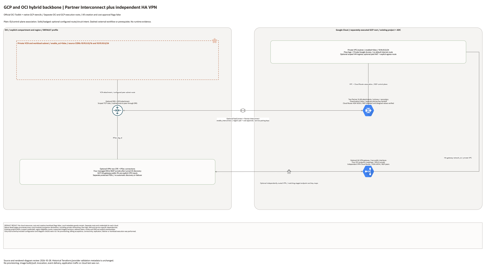

# GCP and OCI Hybrid Network Backbone

| Item | Details |
| --- | --- |
| Best fit | Private dedicated connectivity plus an independently routed HA VPN backup. |
| OCI root | Explicit compartment, region and DEFAULT profile; independently reviewed plan. |
| GCP root | Separate `gcp/` execution, ADC identity, project, region and deployment state. |
| Safe defaults | All creation, workload and cost approval flags false. |
| Evidence | Local schema/mocked checks only; no live cloud acceptance. |

## Deployment Purpose

Private dedicated connectivity plus an independently routed HA VPN backup.

OCI creates a private VCN/subnet, scoped security list, DRG/VCN attachment and optional primary/secondary partner FastConnect VCs. The separate GCP root creates VPC/subnet flow logs, Cloud Router and two Partner VLAN attachments. Optional HA VPN uses its own Cloud Router ASN, two Google public interfaces, two OCI CPE/IPSec connections and four IKEv2 tunnels/BGP peers.

## Architecture



[Editable overview and native resource pages](architecture/architecture.drawio) · [Architecture notes](architecture/README.md)

## Prerequisites

- Explicit approved OCI compartment/region and separately approved Google project/billing.
- OCI profile DEFAULT unless the operator explicitly changes it; Google ADC is independent.
- Required Google Compute and service-specific APIs pre-enabled by the project owner.
- Non-overlapping routed cloud, workload, pod, service, control-plane and service-peering ranges.
- Appropriate regional service quota, supported versions, IAM permissions and approved cost scope.
- Existing circuits/VPN, private DNS, routing and transport where the workload pattern references them.
- Protected secret inputs and separately owned backend/deployment records for each cloud root.

## Configuration

Copy both disabled `terraform.tfvars.example` files into ignored local inputs.
Review the OCI and GCP plans independently. No directory reads the other's outputs automatically.
Exchange only the required non-secret identifiers through approved handoff records.
Never commit tokens, passwords, private keys, pairing keys, PSKs or saved plans.

## Deployment Workflow

1. Review ownership, billing, required APIs, versions, quota and address plan.
2. Keep creation disabled and run local validation and mocked tests first.
3. Enable one approved foundation at a time and inspect its saved plan.
4. Configure any conditional service-specific features only after prerequisites are complete.
5. Supply explicit cross-cloud endpoint/identity/route handoffs; no automatic trust is installed.
6. Run positive and negative network, identity and workload acceptance separately.
7. Rehearse data recovery, cutover and rollback before declaring production readiness.
8. Teardown dependency resources first, then foundations; verify both providers' inventories.

## Scope And Limitations

Interconnect pairing keys and assigned BGP addresses require staged handoff. Create GCP foundations first; transfer pairing keys privately to OCI and complete partner provisioning. Enable BGP only after assigned values are reconciled, importing any partner-created interfaces instead of duplicating them. For VPN, create the GCP gateway, pass its two public IPs as primary/secondary OCI CPE inputs, discover the four OCI tunnel IDs/public endpoints, then configure both tunnel maps and matching protected PSKs. The provided VPN BGP priority is 200 versus Interconnect 100 on Google; OCI DRG propagation/import policies and end-to-end preference need separate review. No automatic HA or failover outcome is established.

Paid creation is disabled by default. Local schema validation and mocked plans are not
proof of cloud availability, live permissions, connectivity, HA, RPO/RTO or runtime safety.
No environment was deployed or exercised during this implementation.

## Local Checks

```bash
terraform init -backend=false
terraform validate
terraform test
terraform -chdir=gcp init -backend=false
terraform -chdir=gcp validate
terraform -chdir=gcp test
```

Use the shared `terraform_runner` through `ansible/plan.yml`, `apply.yml`, `destroy.yml`
and the corresponding `gcp-*.yml` runners. Apply/destroy confirmations remain enforced.
The GCP source entry is `gcp/infrastructure.tf`; Terraform loads all `.tf` files there.

## Cleanup And Ownership

Use dedicated deployment backends and protected local inputs for each cloud.
Deletion-protected resources need an explicit reviewed protection change before teardown.
Versioned backup buckets retain data and use force_destroy=false; archive or remove data explicitly.
Do not delete existing OCI networks, project APIs, shared identities or operator-managed circuits.
No cloud deployment occurred here, so no live cleanup or API inventory was claimed.

## References

[Provider/service design reference](https://docs.cloud.google.com/network-connectivity/docs/vpn/how-to/creating-ha-vpn).
[Validation and handoff record](../../../docs/multicloud/GCP-COUNTERPARTS-20261028.md).
