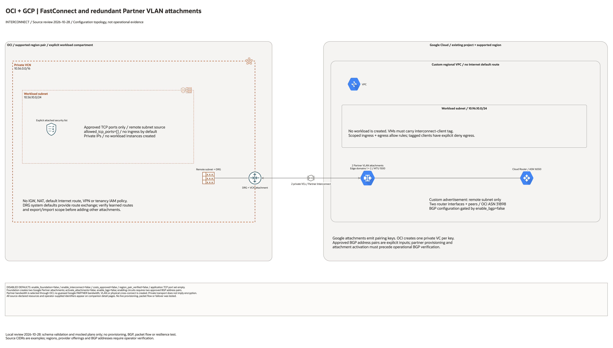

# OCI + Google Cloud Partner Interconnect Architecture

## Deployment Purpose

Provide a source-bounded deployment topology for dedicated interconnect with
both OCI and GCP networking resources declared. Provider activation steps
remain visible and are not represented as successfully completed resources.

## Architecture At A Glance

| Layer | Components |
| --- | --- |
| OCI foundation | Explicit compartment; VCN, private subnet, attached security list, route table, DRG and VCN attachment. |
| GCP foundation | Custom VPC, private subnet, regional Cloud Router and two Partner attachments in different edge availability domains. |
| GCP access | Approved TCP ingress/egress rules plus deny-all egress for `interconnect-client` tagged workloads. No workload is created. |
| GCP BGP | Optional router interfaces and peers for both attachments; configured only after partner provisioning and address reconciliation. |
| OCI circuits | Two private virtual circuits, using the pairing key for the corresponding attachment. |
| Controls | Disabled creation defaults, cost/eligibility guards and approved TCP port list. |

## Architecture



[Editable draw.io diagram](architecture.drawio)

The overview uses source default CIDRs as examples. Regions and offering IDs
remain operator inputs. Connections show configuration intent, not tested
traffic. All detail pages are included in the main editable document.

## Resource Detail And Coverage

Resource maps enumerate root declarations, including disabled and collection
resources. Counts are declarations, not expanded resource instances. Existing
identifiers and override inputs are documented separately from created assets.
The [inventory](resource-inventory.json) records source hashes and node mappings.

| Scope | Declarations / references | PNG | Editable source |
| --- | --- | --- | --- |
| Contracts resources | 1 | [PNG](contracts-resources.png) | [draw.io](contracts-resources.drawio) |
| GCP resources | 9 | [PNG](gcp-resources.png) | [draw.io](gcp-resources.drawio) |
| OCI resources | 7 | [PNG](oci-resources.png) | [draw.io](oci-resources.drawio) |
| Existing identifiers | 3 | [PNG](existing-resources.png) | [draw.io](existing-resources.drawio) |


## Terraform Components

- `main.tf`: OCI and remote resources plus input guards.
- `variables.tf`: explicit provider ownership, region pair, ports and circuit inputs.
- `locals.tf`: naming and address-range checks.
- `providers.tf` / `versions.tf`: credentials through provider chains and exact tested provider versions.
- `outputs.tf`: selected resource identifiers and runbook hand-off.
- `tests/configuration-regressions.tftest.hcl`: isolated mocked plans and rejection cases.
- `ansible/*.yml`: shared guarded runner, no automatic apply.

## Request And Deployment Flow

1. Confirm existing Google project, billing, Compute API, IAM and current supported region pair.
2. Set `costs_approved=true` and `enable_foundation=true`; review the plan before any apply.
3. Create the private networks, Cloud Router and both Partner VLAN attachments.
4. Read `pairing_keys` securely and confirm the provider service and approved BGP addressing for each edge. Do not commit keys or assigned addresses.
5. Set `region_pair_verified=true`, `provider_service_id`, both `bgp_sessions` entries and `enable_interconnect=true`; review the two OCI private circuit requests.
6. Wait for partner provisioning. Refresh the attachments and reconcile the input BGP addresses with the actual assigned Cloud Router/customer addresses before enabling BGP.
7. Set `activate_attachments=true` after review and `enable_bgp=true` to configure the router interfaces and OCI peers. Import any partner-created interface/peer instead of creating a duplicate.
8. Verify both BGP sessions, advertisements, effective routes, bidirectional permitted traffic and single-edge loss using separately approved test workloads.
9. Before teardown, coordinate partner termination, remove BGP configuration/attachments and both OCI circuits, then remove the remaining foundation and verify both clouds.

## Traffic And Trust Boundaries

- OCI subnet blocks public IP assignment and attaches the explicit security list.
- Application traffic is limited to the opposite workload subnet and approved ports. Default port set is empty.
- No public workload, Internet gateway, NAT or Internet default route is created.
- Provider service, pairing/activation key and region eligibility are external contracts, not discovered account permissions.
- System DRG routing must be checked for learned prefixes and export scope before expanding the topology.
- Existing organization service perimeters, account controls and application encryption remain operator prerequisites.

## Detailed Architecture Notes

Two Google attachments use separate edge domains and MTU 1500. Google PARTNER bandwidth and VLAN assignment belong to the partner. The two OCI circuit requests use the corresponding pairing keys. Google interfaces and peers remain disabled until assigned address reconciliation. This is a regional topology, not an automatic multi-region disaster-recovery deployment.

## Operational Boundaries

Only schema validation and mocked plans were run for this change. No cloud
resource was created, no route or BGP session was observed, and no packet-flow,
resilience, latency, encryption or cleanup test was performed. Production
acceptance requires a separately approved deployment and evidence from both clouds.

Regenerate with the installed `oci-architecture-diagrams` skill and Oracle
Toolkit v24.2; external resources use mapped native provider icons. Unmapped
associations and metadata use named boxes.

```bash
python3 scripts/diagrams/interconnect-batch-01.py --render
python3 scripts/diagrams/multicloud-resource-coverage.py --blueprint networking/gcp-oci-partner-interconnect --render
python3 scripts/diagrams/multicloud-resource-coverage.py --blueprint networking/gcp-oci-partner-interconnect --check
```

## Review Checklist

- Confirm current region pair, offering, provider service, account/project and bandwidth.
- Review both cloud plans and cost scope before any apply.
- Verify non-overlapping CIDRs, private subnet placement and explicit application ports.
- Complete partner activation and reconcile ownership of all provider-created objects.
- Inspect effective routes and both directions of permitted traffic using approved workloads.
- Test resilience and teardown with evidence before declaring operational readiness.

## Official References

- [Oracle Interconnect for Google Cloud](https://docs.oracle.com/en-us/iaas/Content/multicloud/interconnect-gcp.htm)
- [Google Partner Interconnect VLAN attachments](https://cloud.google.com/network-connectivity/docs/interconnect/how-to/partner/creating-vlan-attachments)
- [Google attachment provider schema](https://registry.terraform.io/providers/hashicorp/google/latest/docs/resources/compute_interconnect_attachment)
