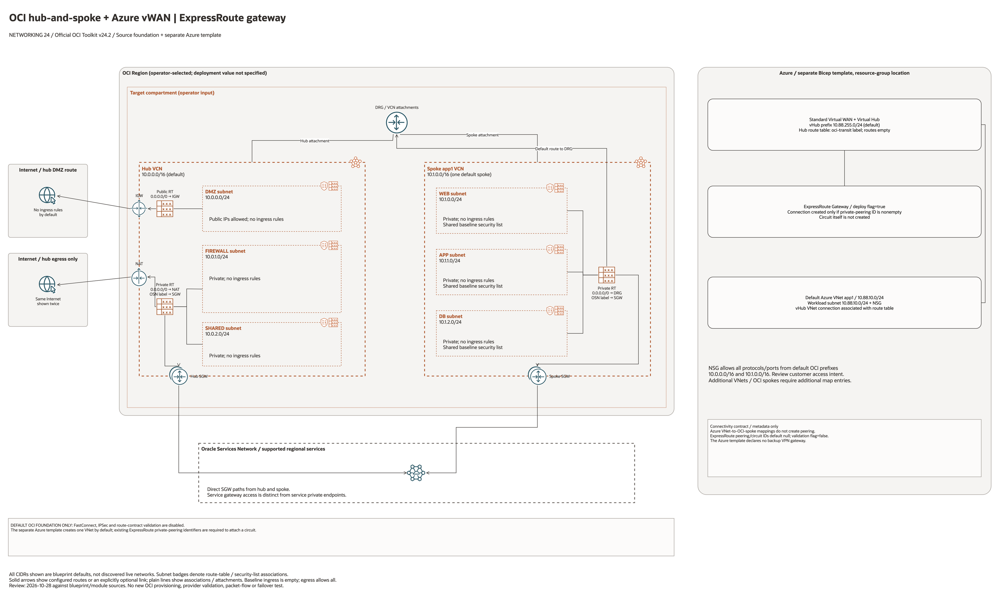

# Hub-Spoke With Azure vWAN ExpressRoute Architecture

This page is the deployment architecture for
`blueprints/networking/hub-spoke-with-azure-vwan-expressroute`. It keeps the
Azure Virtual WAN model explicit while preserving the OCI hub-spoke foundation.

## Deployment Purpose

Connect an OCI hub-spoke network to Azure Virtual WAN through Azure ExpressRoute
Gateway and OCI FastConnect, with Azure VNets connected to the Virtual Hub and
mapped to OCI spoke VCNs for route governance.

## Architecture At A Glance

| Item | Details |
| --- | --- |
| Boundary | `blueprints/networking/hub-spoke-with-azure-vwan-expressroute` owns the OCI Terraform folder and Azure deployment session. |
| Purpose | OCI hub DRG to Azure vWAN/vHub private transit with ExpressRoute Gateway and VNet connections. |
| Terraform components | `network`, `fastconnect`, `ipsec_vpn`, `terraform_data.azure_vwan_contract` |
| Azure components | `Microsoft.Network/virtualWans`, `virtualHubs`, `expressRouteGateways`, `hubVirtualNetworkConnections`, `virtualNetworks`, `networkSecurityGroups` |
| Primary architecture view | The diagram shows the default OCI foundation and separate Azure template, with incomplete circuit inputs and conditional links identified. |

## Architecture

[Editable draw.io source](architecture.drawio). Keep the PNG aligned with this
editable source after diagram changes.

Generated with the [oci-architecture-diagrams skill](https://github.com/leandro-michelino/oci-architecture-diagrams)
and Oracle OCI Architecture Diagram Toolkit v24.2. Regenerate from the repository
root with `python3 scripts/diagrams/networking-batch-05.py --render`, after
installing the skill and its official toolkit. The toolkit is not redistributed here.

The diagram distinguishes source-defined resources, conditional enablement,
supplied network references and metadata contracts. CIDRs are source defaults or
explicitly marked TBC; deployment placement remains an operator input.

Diagram documentation reviewed on 2026-10-28 against root Terraform, referenced
modules and any accompanying Bicep template. No cloud resources were provisioned
and no Terraform/provider validation date was changed. The picture is not proof
of routing, backend health, traffic isolation, BGP or failover.

## Terraform Components

| Kind | Name | Source Or Role |
| --- | --- | --- |
| Module | `network` | Creates OCI hub VCN, DRG, spoke VCNs, subnets, and DRG attachments. |
| Module | `fastconnect` | Creates OCI FastConnect virtual circuit for Azure ExpressRoute private path. |
| Module | `ipsec_vpn` | Optional backup or test tunnel metadata and OCI IPSec resources. |
| Resource | `terraform_data.azure_vwan_contract` | Captures Azure vWAN, vHub, ExpressRoute Gateway, CIDRs, and spoke-to-VNet mappings. |
| Azure template | `azure/main.bicep` | Creates Azure vWAN/vHub, ExpressRoute Gateway, vHub route table, VNets, NSGs, and vHub VNet connections. |

## Request And Deployment Flow

- Operator reviews OCI and Azure CIDRs, route domains, and ExpressRoute ownership.
- Azure session creates or updates Virtual WAN, Virtual Hub, ExpressRoute Gateway, and Azure VNets.
- OCI Terraform creates the hub-spoke topology and FastConnect resources.
- Azure deployment outputs are copied into local Terraform variables for a complete `azure_vwan_contract`.
- Operators validate BGP route exchange, vHub route table association, and spoke-to-VNet reachability.

## Traffic And Trust Boundaries

- OCI control plane operations use the OCI provider credentials configured for this folder.
- Azure control plane operations use Azure CLI credentials through the shared Azure deployment runner.
- OCI data plane traffic leaves spoke VCNs through the DRG and FastConnect virtual circuit.
- Azure data plane traffic leaves connected VNets through Virtual Hub, ExpressRoute Gateway, and ExpressRoute private peering.
- Trust boundaries are the OCI tenancy, network compartment, VCNs, DRG, Azure subscription, resource group, Virtual Hub, and ExpressRoute circuit.
- Secrets, authorization keys, provider service keys, OCIDs, and customer-specific CIDRs belong in ignored local files or pipeline secrets.

## Detailed Architecture Notes

- The OCI provider preserves the automatically assigned `Oracle-Tags.CreatedBy` and `Oracle-Tags.CreatedOn` provenance tags through `ignore_defined_tags`. Other defined tags remain managed. See [Oracle provider troubleshooting](https://docs.oracle.com/en-us/iaas/Content/dev/terraform/troubleshooting.htm).

- OCI remains the hub-spoke owner: the DRG attaches to the hub and each spoke VCN.
- Azure vWAN is explicit: Azure VNets connect to the Virtual Hub instead of being modeled as generic remote CIDRs.
- ExpressRoute Gateway is the Azure transit edge for the private interconnect path.
- FastConnect is the OCI transit edge for the private interconnect path.
- `azure_vnet_peerings` maps Azure VNet CIDRs to OCI spoke keys so runbooks can reason about app-to-app routes.
- `enable_route_contract_validation` can be disabled for early offline plans before real ExpressRoute IDs exist.
- Optional IPSec is kept separate so a customer can add backup connectivity without changing the vWAN contract.

## Operational Boundaries

- Keep the Azure Bicep parameters aligned with Terraform CIDRs before running Azure what-if.
- Run Azure what-if before Azure apply, then copy the Azure output IDs back into Terraform variables.
- Treat Terraform apply, Azure apply, and destroy operations as approval-gated.
- Re-check overlapping CIDRs, route propagation labels, BGP ASN ownership, and ExpressRoute authorization before production route advertisement.
- Update this architecture file whenever `main.tf`, `variables.tf`, `outputs.tf`, or `azure/main.bicep` changes.

## Review Checklist

- Confirm the diagram matches `main.tf`: `network`, `fastconnect`, `ipsec_vpn`, and `terraform_data.azure_vwan_contract`.
- Confirm the diagram matches `azure/main.bicep`: vWAN, vHub, vHub route table, ExpressRoute Gateway, VNet connections, VNets, subnets, and NSGs.
- Confirm OCI hub and spoke CIDRs are advertised to Azure and Azure VNet CIDRs are advertised to OCI.
- Confirm ExpressRoute private peering and FastConnect provider details are paired correctly.
- Confirm Azure vHub route table labels and propagated route settings match the intended route domain.
- Confirm no local tfvars, plan files, provider service keys, or ExpressRoute authorization keys are committed.
