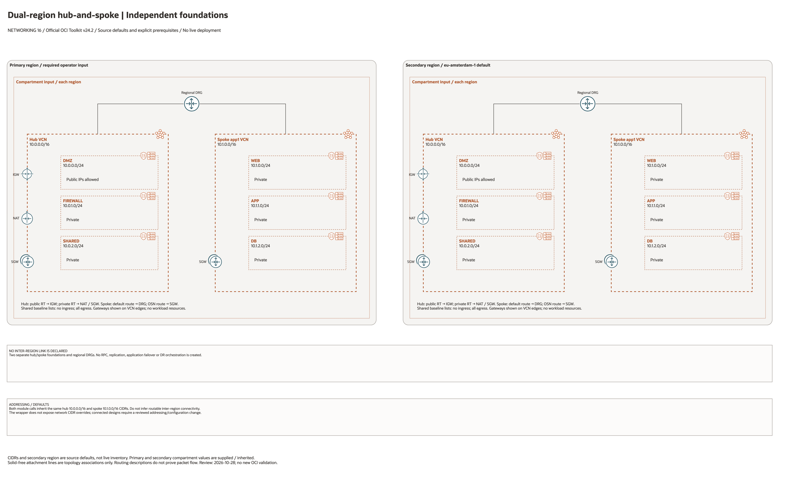

# Dual Region Hub-Spoke DR Architecture

This is the deployment architecture for `blueprints/networking/hub-spoke-with-dual-region-dr`. The PNG provides a GitHub-readable preview; the draw.io source preserves editable shapes, official OCI icons and connectors.

## Deployment Purpose

Creates matching hub-spoke network foundations in primary and secondary OCI regions for regional disaster recovery patterns.

## Architecture At A Glance

| Item | Details |
| --- | --- |
| Boundary | `blueprints/networking/hub-spoke-with-dual-region-dr` owns this deployment folder and its Terraform + Ansible runners. |
| Purpose | Creates matching hub-spoke network foundations in primary and secondary OCI regions for regional disaster recovery patterns. |
| Terraform components | `primary_network`, `secondary_network` |
| Primary architecture view | The diagram shows source-defined resources, explicit dependency/contract boundaries and conditional connectivity; it is not runtime evidence. |


## Architecture



[Editable draw.io source](architecture.drawio). Keep this source and the PNG preview
aligned after every diagram change.

Generated with the [oci-architecture-diagrams skill](https://github.com/leandro-michelino/oci-architecture-diagrams)
and Oracle OCI Architecture Diagram Toolkit v24.2. Regenerate from the repository
root with `python3 scripts/diagrams/networking-batch-04.py --render`, after
installing the skill and its official toolkit. The toolkit is not redistributed here.

The diagram uses source-default CIDRs, explicitly identifies incomplete inputs,
and distinguishes network resources from external dependencies and metadata
contracts. Placement labels are defaults or operator inputs, not live inventory.

Diagram documentation reviewed on 2026-10-28 against root Terraform, referenced
modules, and any accompanying CloudFormation/Bicep template. No cloud resources
were provisioned and no Terraform/provider validation date was changed.
This diagram is not evidence of connectivity, BGP, failover or DR readiness.

## Resource Detail And Coverage

Reviewed against the updated diagram standard on October 28, 2026. The main
draw.io document contains the topology overview plus every resource-detail and
existing-resource-reference page below. Source declarations include disabled and
collection-based resources from root Terraform, recursively pinned modules and
companion cloud templates. Counts are declarations, not resolved instance counts.

OCI uses Oracle Toolkit icons; Azure and AWS use their respective draw.io icons.
Types without a specific mapped icon retain their exact name and type in a box.
No GCP declarations were found in this fixed 39-blueprint scope.

| Detail page | Declarations | PNG | Editable source |
| --- | --- | --- | --- |
| OCI resources | 18 | [PNG](oci-resources.png) | [draw.io](oci-resources.drawio) |
| OCI resources 2 | 18 | [PNG](oci-resources-02.png) | [draw.io](oci-resources-02.drawio) |

[Existing resources and override inputs](existing-resources.png) | [Editable reference page](existing-resources.drawio)

[Source inventory](resource-inventory.json) records exact declarations, full
creation expressions, module call-site gates/enablement inputs, pinned revisions,
source hashes and diagram node mappings. Identifier-input references are listed
separately from managed resources. Null/empty inputs do not prove an external
resource exists; collection schemas may contain additional resource identifiers.

The overview explains default enablement. Resource cards enumerate all declaration
branches and do not imply deployment, ownership adoption, packet flow, security
enforcement or recovery success. No historical Terraform validation date changed.

```bash
python3 scripts/diagrams/multicloud-resource-coverage.py --blueprint networking/hub-spoke-with-dual-region-dr --render
python3 scripts/diagrams/multicloud-resource-coverage.py --blueprint networking/hub-spoke-with-dual-region-dr --check
```

If regenerating the overview first, rebuild these detail pages afterward.
See [the fixed first-39 review](../../../../docs/diagrams/FIRST-39-REVIEW.md) and [provider icon sources](../../../../scripts/diagrams/assets/README.md).

## Terraform Components

| Kind | Name | Source Or Role |
| --- | --- | --- |
| Module | `primary_network` | `blueprints/networking/hub-spoke-with-drg-and-three-tier-vcns @ d7938f4baef1aa512fc8dcee99a545ec17e0dab2` |
| Module | `secondary_network` | `blueprints/networking/hub-spoke-with-drg-and-three-tier-vcns @ d7938f4baef1aa512fc8dcee99a545ec17e0dab2` |

## Request And Deployment Flow

- Operator reviews CIDRs, subnet maps, gateway flags, route targets, and inspection requirements.
- Terraform creates the network foundation first, then dependent attachments or network services declared in main.tf.
- Traffic follows the diagrammed route path, and outputs expose VCN, subnet, DRG, gateway, DNS, inspection, or policy IDs for the next deployment.

## Traffic And Trust Boundaries

- Control plane traffic is local operator or CI authentication into the OCI provider and the Ansible Terraform runner.
- Data plane traffic is the packet or service path shown in the Architecture diagram; if this deployment only creates identity or governance resources, the data plane is intentionally permission and signal flow instead of network packets.
- Trust boundaries are the tenancy, compartment, VCN, subnet, DRG, private endpoint, identity domain, or managed service edges shown in the diagram.
- Secrets, OCIDs, customer CIDRs, endpoint URLs, and contact data belong in ignored local tfvars or a secure pipeline variable store, not in committed files.

## Detailed Architecture Notes

- The OCI provider preserves the automatically assigned `Oracle-Tags.CreatedBy` and `Oracle-Tags.CreatedOn` provenance tags through `ignore_defined_tags`. Other defined tags remain managed. See [Oracle provider troubleshooting](https://docs.oracle.com/en-us/iaas/Content/dev/terraform/troubleshooting.htm).

These notes expand the diagram with the design details that usually matter during review, plan, and hand-off.

- The primary and secondary hub-spoke networks are independent module instances with separate region and region_key values.
- Each region receives its own hub VCN, DRG, spoke VCNs, subnets, gateways, and DRG attachments.
- Cross-region replication, DNS steering, and disaster recovery orchestration are intentionally external layers that consume these network outputs.
- The key review is CIDR separation and operational parity between primary and secondary regions.

## Operational Boundaries

- Keep customer-specific OCIDs, CIDRs, DNS names, endpoints, contacts, and secrets in ignored local tfvars or approved pipeline variables.
- Run plan from this blueprint folder so relative module paths, provider files, and local Ansible runners resolve predictably.
- Treat apply and destroy as approval-gated operations; use the guarded Ansible playbooks or a reviewed Terraform workflow.
- Re-check route exposure, IAM scope, compartment boundaries, tags, and output hand-offs whenever inputs change.

## Review Checklist

- Confirm the diagram matches `main.tf`: `primary_network`, `secondary_network`.
- Confirm the described traffic path is the path you want in OCI before apply.
- Confirm public exposure, private endpoint access, DNS behavior, DRG routing, and inspection points are intentional where present.
- Confirm IAM scopes, compartment boundaries, tags, and operational outputs match the deployment README.
- Confirm `ansible/plan.yml`, `ansible/apply.yml`, and `ansible/destroy.yml` still point at the shared Terraform runner.
