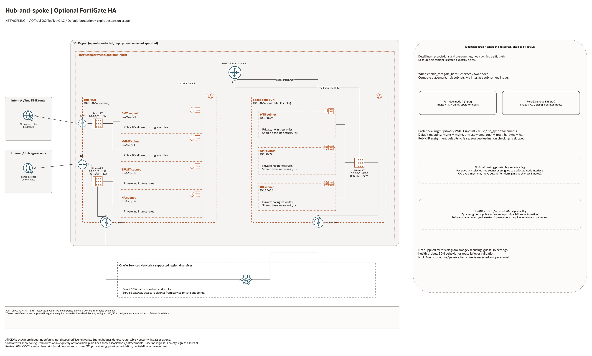

# Hub-Spoke FortiGate HA Architecture

This is the deployment architecture for `blueprints/networking/hub-spoke-with-fortigate-ha`. The PNG provides a GitHub-readable preview; the draw.io source preserves editable shapes, official OCI icons and connectors.

## Deployment Purpose

Deploys a Fortinet FortiGate active-passive HA pair into a hub-spoke network for customer-managed inspection.

## Architecture At A Glance

| Item | Details |
| --- | --- |
| Boundary | `blueprints/networking/hub-spoke-with-fortigate-ha` owns this deployment folder and its Terraform + Ansible runners. |
| Purpose | Deploys a Fortinet FortiGate active-passive HA pair into a hub-spoke network for customer-managed inspection. |
| Terraform components | `network`, `oci_core_instance.fortigate`, `oci_core_vnic_attachment.fortigate_interface`, optional floating private IPs and IAM failover policy |
| Primary architecture view | The diagram shows the default foundation and an explicit extension detail panel, with conditional resources and scope limits marked. |


## Architecture



[Editable draw.io source](architecture.drawio). Keep the PNG preview aligned with
the editable source after every diagram change.

Generated with the [oci-architecture-diagrams skill](https://github.com/leandro-michelino/oci-architecture-diagrams)
and Oracle OCI Architecture Diagram Toolkit v24.2. From the repository root,
regenerate with `python3 scripts/diagrams/networking-batch-03.py --render`.
Install the skill and its official toolkit first; the toolkit is not redistributed here.

The foundation view uses source-default CIDRs and leaves deployment region and
compartment as operator inputs. The extension detail panel distinguishes default
resources, disabled conditional resources, associations and missing prerequisites.
It does not assert verified packet flow, HA, failover or policy enforcement.

Diagram documentation reviewed on 2026-10-28 against the blueprint and referenced
modules. No OCI resources were provisioned and no Terraform/provider validation
date was changed for this documentation update.

## Resource Detail And Coverage

Reviewed against the updated diagram standard on October 28, 2026. The main
draw.io document contains the topology overview plus every resource-detail and
existing-resource-reference page below. Source declarations include disabled and
collection-based resources from root Terraform, recursively pinned modules and
companion cloud templates. Counts are declarations, not resolved instance counts.

OCI uses Oracle Toolkit icons; Azure and AWS use their respective draw.io icons.
Types without a specific mapped icon retain their exact name and type in a box.
No GCP declarations were found in this fixed 39-blueprint scope.

| Detail page | Declarations | PNG | Editable source |
| --- | --- | --- | --- |
| Contracts resources | 1 | [PNG](contracts-resources.png) | [draw.io](contracts-resources.drawio) |
| OCI resources | 18 | [PNG](oci-resources.png) | [draw.io](oci-resources.drawio) |
| OCI resources 2 | 5 | [PNG](oci-resources-02.png) | [draw.io](oci-resources-02.drawio) |

[Existing resources and override inputs](existing-resources.png) | [Editable reference page](existing-resources.drawio)

[Source inventory](resource-inventory.json) records exact declarations, full
creation expressions, module call-site gates/enablement inputs, pinned revisions,
source hashes and diagram node mappings. Identifier-input references are listed
separately from managed resources. Null/empty inputs do not prove an external
resource exists; collection schemas may contain additional resource identifiers.

The overview explains default enablement. Resource cards enumerate all declaration
branches and do not imply deployment, ownership adoption, packet flow, security
enforcement or recovery success. No historical Terraform validation date changed.

```bash
python3 scripts/diagrams/multicloud-resource-coverage.py --blueprint networking/hub-spoke-with-fortigate-ha --render
python3 scripts/diagrams/multicloud-resource-coverage.py --blueprint networking/hub-spoke-with-fortigate-ha --check
```

If regenerating the overview first, rebuild these detail pages afterward.
See [the fixed first-39 review](../../../../docs/diagrams/FIRST-39-REVIEW.md) and [provider icon sources](../../../../scripts/diagrams/assets/README.md).

## Terraform Components

| Kind | Name | Source Or Role |
| --- | --- | --- |
| Module | `network` | `blueprints/networking/hub-spoke-with-drg-and-three-tier-vcns @ d7938f4baef1aa512fc8dcee99a545ec17e0dab2` |
| Resource | `oci_core_instance.fortigate` | FortiGate active and standby compute nodes with management as the primary VNIC. |
| Resource | `oci_core_vnic_attachment.fortigate_interface` | Secondary untrust, trust, and HA sync VNICs attached to each FortiGate node. |
| Resource | `oci_core_private_ip.fortigate_floating` | Optional secondary or reserved private IPs used by failover automation and route-table next hops. |
| Resource | `oci_identity_dynamic_group.fortigate` | Optional instance-principal dynamic group matching the FortiGate nodes. |
| Resource | `oci_identity_policy.fortigate` | Optional tenancy policy for Fortinet-documented OCI SDN connector failover permissions. |
| Resource | `terraform_data.fortigate_input_validation` | Local validation or metadata; does not provision cloud network services. |

## Request And Deployment Flow

- Operator reviews FortiGate licensing, image source, interface placement, bootstrap method, and failover ownership.
- Terraform creates the hub-spoke network first, then creates the FortiGate compute nodes with management VNICs.
- Terraform attaches secondary untrust, trust, and HA sync VNICs after each node exists.
- Optional reserved private IPs are created for route-table next hops and FortiGate HA failover.
- Optional IAM resources allow the FortiGate nodes to use instance principals for private IP failover automation.
- Traffic follows the diagrammed route path only after the operator updates the relevant route tables and completes FortiGate policy configuration.

## Traffic And Trust Boundaries

- Control plane traffic is local operator or CI authentication into the OCI provider and the Ansible Terraform runner.
- FortiGate management traffic belongs on the management subnet and should be reachable only from approved administrative paths.
- Untrust traffic belongs on the DMZ or edge-facing subnet and should be limited by the customer security-list or NSG model.
- Trust traffic belongs on the transit or inspected-side subnet used by DRG and spoke routing decisions.
- HA sync traffic belongs on a dedicated private subnet or an equivalent isolated path approved by the network team.
- Secrets, OCIDs, customer CIDRs, endpoint URLs, and contact data belong in ignored local tfvars or a secure pipeline variable store, not in committed files.

## Detailed Architecture Notes

- The OCI provider preserves the automatically assigned `Oracle-Tags.CreatedBy` and `Oracle-Tags.CreatedOn` provenance tags through `ignore_defined_tags`. Other defined tags remain managed. See [Oracle provider troubleshooting](https://docs.oracle.com/en-us/iaas/Content/dev/terraform/troubleshooting.htm).

These notes expand the diagram with the design details that usually matter during review, plan, and hand-off.

- The FortiGate management interface is the primary VNIC because OCI Compute instances are created with one primary VNIC and then receive secondary interface attachments.
- Secondary VNICs use `skip_source_dest_check = true` by default so the appliance can forward inspected traffic.
- The default hub subnets separate `dmz`, `mgmt`, `trust`, and `ha` roles; customers can override the subnet map and interface subnet keys.
- Floating private IPs can be created as reserved private IPs or initially attached as secondary IPs on the active FortiGate VNIC; Terraform ignores `vnic_id` drift so FortiGate HA can move them during failover.
- The optional dynamic group matches the created FortiGate instance OCIDs and the optional policy follows the Fortinet-documented OCI SDN connector IAM role permissions for read access and IP/VNIC failover automation.
- The blueprint does not hard-code FortiOS firewall rules, SDN connector settings, FortiManager registration, license activation, or production route steering; those remain customer or security-team owned steps.
- Route symmetry must be reviewed carefully when steering spoke-to-spoke, internet, VPN, FastConnect, service gateway, or NAT paths through FortiGate.

## Operational Boundaries

- Keep customer-specific OCIDs, CIDRs, DNS names, endpoints, contacts, and secrets in ignored local tfvars or approved pipeline variables.
- Accept marketplace terms and confirm licensing outside Terraform before enabling FortiGate nodes.
- Run plan from this blueprint folder so provider files and local Ansible runners resolve predictably.
- Treat apply and destroy as approval-gated operations; use the guarded Ansible playbooks or a reviewed Terraform workflow.
- Re-check route exposure, IAM scope, compartment boundaries, tags, and output hand-offs whenever inputs change.
- Validate FortiGate HA failover in a non-production routing path before production traffic depends on the pair.

## Review Checklist

- Confirm the diagram matches `main.tf`: `network`, `oci_core_instance.fortigate`, `oci_core_vnic_attachment.fortigate_interface`, optional private IPs, and optional IAM resources.
- Confirm the described traffic path is the path you want in OCI before apply.
- Confirm public exposure, private endpoint access, DNS behavior, DRG routing, and inspection points are intentional where present.
- Confirm FortiGate image, license model, support ownership, bootstrap method, and FortiManager onboarding are approved.
- Confirm IAM scopes, compartment boundaries, tags, and operational outputs match the deployment README.
- Confirm `ansible/plan.yml`, `ansible/apply.yml`, and `ansible/destroy.yml` still point at the shared Terraform runner.
