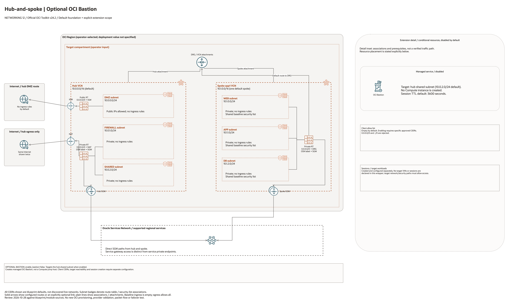

# Hub-Spoke Bastion Jump Host Architecture

This is the deployment architecture for `blueprints/networking/hub-spoke-with-hub-vcn-bastion-jump-host`. The PNG provides a GitHub-readable preview; the draw.io source preserves editable shapes, official OCI icons and connectors.

## Deployment Purpose

Adds OCI Bastion access to the hub-spoke landing-zone network so administrators can reach private targets without public host exposure.

## Architecture At A Glance

| Item | Details |
| --- | --- |
| Boundary | `blueprints/networking/hub-spoke-with-hub-vcn-bastion-jump-host` owns this deployment folder and its Terraform + Ansible runners. |
| Purpose | Adds OCI Bastion access to the hub-spoke landing-zone network so administrators can reach private targets without public host exposure. |
| Terraform components | `network`, `bastion` |
| Primary architecture view | The diagram shows the default foundation and an explicit extension detail panel, with conditional resources and scope limits marked. |

## Architecture

[Editable draw.io source](architecture.drawio). Keep the PNG preview aligned with
the editable source after every diagram change.

Generated with the [oci-architecture-diagrams skill](https://github.com/leandro-michelino/oci-architecture-diagrams)
and Oracle OCI Architecture Diagram Toolkit v24.2. From the repository root,
regenerate with `python3 scripts/diagrams/networking-batch-03.py --render`.
Install the skill and its official toolkit first; the toolkit is not redistributed here.

The foundation view uses source-default CIDRs and leaves deployment region and
compartment as operator inputs. The extension detail panel distinguishes default
resources, disabled conditional resources, associations and missing prerequisites.
It does not assert verified packet flow, HA, failover or policy enforcement.

Diagram documentation reviewed on 2026-10-28 against the blueprint and referenced
modules. No OCI resources were provisioned and no Terraform/provider validation
date was changed for this documentation update.

## Terraform Components

| Kind | Name | Source Or Role |
| --- | --- | --- |
| Module | `network` | `blueprints/networking/hub-spoke-with-drg-and-three-tier-vcns @ d7938f4baef1aa512fc8dcee99a545ec17e0dab2` |
| Module | `bastion` | `modules/security/bastion @ v0.2.0` |

## Request And Deployment Flow

- Operator reviews CIDRs, subnet maps, gateway flags, route targets, and inspection requirements.
- Terraform creates the network foundation first, then dependent attachments or network services declared in main.tf.
- Traffic follows the diagrammed route path, and outputs expose VCN, subnet, DRG, gateway, DNS, inspection, or policy IDs for the next deployment.

## Traffic And Trust Boundaries

- Control plane traffic is local operator or CI authentication into the OCI provider and the Ansible Terraform runner.
- Data plane traffic is the packet or service path shown in the Architecture diagram; if this deployment only creates identity or governance resources, the data plane is intentionally permission and signal flow instead of network packets.
- Trust boundaries are the tenancy, compartment, VCN, subnet, DRG, private endpoint, identity domain, or managed service edges shown in the diagram.
- Secrets, OCIDs, customer CIDRs, endpoint URLs, and contact data belong in ignored local tfvars or a secure pipeline variable store, not in committed files.

## Detailed Architecture Notes

- Current validation: The 2026-10-23 DEFAULT Sao Paulo plan includes only the hub/spoke network; Bastion is disabled by default and requires approved client CIDRs before a separate session test. See [Networking review](../../../../docs/NETWORKING-REVIEW-20261023-61-70.md).

- The OCI provider preserves the automatically assigned `Oracle-Tags.CreatedBy` and `Oracle-Tags.CreatedOn` provenance tags through `ignore_defined_tags`. Other defined tags remain managed. See [Oracle provider troubleshooting](https://docs.oracle.com/en-us/iaas/Content/dev/terraform/troubleshooting.htm).

These notes expand the diagram with the design details that usually matter during review, plan, and hand-off.

- The hub-spoke network is created first, then OCI Bastion is placed in the selected hub subnet.
- client_cidr_block_allow_list and max_session_ttl_in_seconds define the administrative access envelope.
- Bastion sessions reach private IP targets through the routed hub/spoke network without assigning public IPs to targets.
- Review the bastion subnet, route tables, NSGs/security lists, and target host access before enabling production sessions.

## Operational Boundaries

- Keep customer-specific OCIDs, CIDRs, DNS names, endpoints, contacts, and secrets in ignored local tfvars or approved pipeline variables.
- Run plan from this blueprint folder so relative module paths, provider files, and local Ansible runners resolve predictably.
- Treat apply and destroy as approval-gated operations; use the guarded Ansible playbooks or a reviewed Terraform workflow.
- Re-check route exposure, IAM scope, compartment boundaries, tags, and output hand-offs whenever inputs change.

## Review Checklist

- Confirm the diagram matches `main.tf`: `network`, `bastion`.
- Confirm the described traffic path is the path you want in OCI before apply.
- Confirm public exposure, private endpoint access, DNS behavior, DRG routing, and inspection points are intentional where present.
- Confirm IAM scopes, compartment boundaries, tags, and operational outputs match the deployment README.
- Confirm `ansible/plan.yml`, `ansible/apply.yml`, and `ansible/destroy.yml` still point at the shared Terraform runner.
