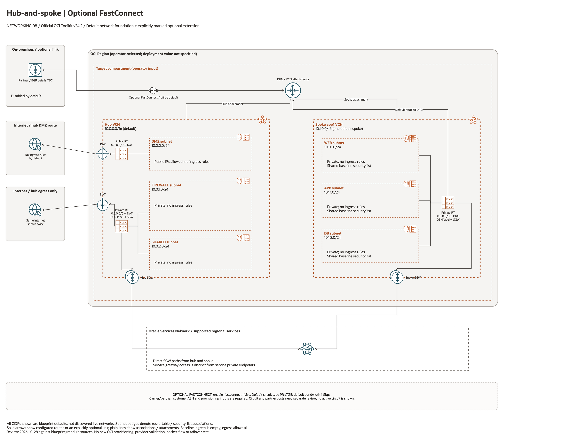

# Hub-Spoke FastConnect Virtual Circuit Architecture

This is the deployment architecture for `blueprints/networking/hub-spoke-with-hub-vcn-fastconnect-vc`. The PNG provides a GitHub-readable preview; the accompanying draw.io file preserves editable shapes, official OCI icons and connectors.

## Deployment Purpose

Adds an OCI FastConnect virtual circuit to the hub-spoke DRG for private on-premises or provider connectivity.

## Architecture At A Glance

| Item | Details |
| --- | --- |
| Boundary | `blueprints/networking/hub-spoke-with-hub-vcn-fastconnect-vc` owns this deployment folder and its Terraform + Ansible runners. |
| Purpose | Adds an OCI FastConnect virtual circuit to the hub-spoke DRG for private on-premises or provider connectivity. |
| Terraform components | `network`, `fastconnect` |
| Primary architecture view | The diagram shows the default network foundation, attachments, routes and explicitly optional extensions; it is not runtime evidence. |


## Architecture



[Editable draw.io source](architecture.drawio). The PNG is the documentation preview.
Keep it aligned with the editable source after every diagram change.

Generated with the [oci-architecture-diagrams skill](https://github.com/leandro-michelino/oci-architecture-diagrams)
and Oracle OCI Architecture Diagram Toolkit v24.2. Regenerate from the repository
root with `python3 scripts/diagrams/networking-batch-02.py --render` after installing
the skill and its official toolkit. The toolkit itself is not stored in this repository.

This view shows the default network foundation. Optional services are explicitly
marked as disabled; their illustrated links are conditional. CIDRs are source
defaults, and the deployment region and compartment remain operator inputs.

Diagram documentation reviewed on 2026-10-28 against the blueprint, its pinned
hub/spoke foundation and referenced modules. No OCI resources were provisioned,
and no Terraform/provider validation date was changed for this documentation update.

## Resource Detail And Coverage

Reviewed against the updated diagram standard on October 28, 2026. The main
draw.io document contains the topology overview plus every resource-detail and
existing-resource-reference page below. Source declarations include disabled and
collection-based resources from root Terraform, recursively pinned modules and
companion cloud templates. Counts are declarations, not resolved instance counts.

OCI uses Oracle Toolkit icons; Azure and AWS use their respective draw.io icons.
Types without a specific mapped icon retain their exact name and type in a box.
No GCP declarations were found in this fixed 39-blueprint scope.

| Detail page | Declarations | PNG | Editable source |
| --- | --- | --- | --- |
| OCI resources | 18 | [PNG](oci-resources.png) | [draw.io](oci-resources.drawio) |
| OCI resources 2 | 1 | [PNG](oci-resources-02.png) | [draw.io](oci-resources-02.drawio) |

[Existing resources and override inputs](existing-resources.png) | [Editable reference page](existing-resources.drawio)

[Source inventory](resource-inventory.json) records exact declarations, full
creation expressions, module call-site gates/enablement inputs, pinned revisions,
source hashes and diagram node mappings. Identifier-input references are listed
separately from managed resources. Null/empty inputs do not prove an external
resource exists; collection schemas may contain additional resource identifiers.

The overview explains default enablement. Resource cards enumerate all declaration
branches and do not imply deployment, ownership adoption, packet flow, security
enforcement or recovery success. No historical Terraform validation date changed.

```bash
python3 scripts/diagrams/multicloud-resource-coverage.py --blueprint networking/hub-spoke-with-hub-vcn-fastconnect-vc --render
python3 scripts/diagrams/multicloud-resource-coverage.py --blueprint networking/hub-spoke-with-hub-vcn-fastconnect-vc --check
```

If regenerating the overview first, rebuild these detail pages afterward.
See [the fixed first-39 review](../../../../docs/diagrams/FIRST-39-REVIEW.md) and [provider icon sources](../../../../scripts/diagrams/assets/README.md).

## Terraform Components

| Kind | Name | Source Or Role |
| --- | --- | --- |
| Module | `network` | `blueprints/networking/hub-spoke-with-drg-and-three-tier-vcns @ d7938f4baef1aa512fc8dcee99a545ec17e0dab2` |
| Module | `fastconnect` | `modules/networking/fastconnect @ v0.2.0` |

## Request And Deployment Flow

- Operator reviews CIDRs, subnet maps, gateway flags, route targets, and inspection requirements.
- Terraform creates the network foundation first, then dependent attachments or network services declared in main.tf.
- Traffic follows the diagrammed route path, and outputs expose VCN, subnet, DRG, gateway, DNS, inspection, or policy IDs for the next deployment.

## Traffic And Trust Boundaries

- Control plane traffic is local operator or CI authentication into the OCI provider and the Ansible Terraform runner.
- Data plane traffic is the packet or service path shown in the Architecture diagram; if this deployment only creates identity or governance resources, the data plane is intentionally permission and signal flow instead of network packets.
- Trust boundaries are the tenancy, compartment, VCN, subnet, DRG, private endpoint, identity domain, or managed service edges shown in the diagram.
- Secrets, OCIDs, customer CIDRs, endpoint URLs, and contact data belong in ignored local tfvars or a secure pipeline variable store, not in committed files.

## Detailed Architecture Notes

- Current validation: The 2026-10-23 DEFAULT Sao Paulo plan includes only the hub/spoke network; FastConnect is disabled by default and needs partner, circuit, and BGP inputs before testing. See [Networking review](../../../../docs/NETWORKING-REVIEW-20261023-61-70.md).

- The OCI provider preserves the automatically assigned `Oracle-Tags.CreatedBy` and `Oracle-Tags.CreatedOn` provenance tags through `ignore_defined_tags`. Other defined tags remain managed. See [Oracle provider troubleshooting](https://docs.oracle.com/en-us/iaas/Content/dev/terraform/troubleshooting.htm).

These notes expand the diagram with the design details that usually matter during review, plan, and hand-off.

- The hub-spoke network exposes the DRG ID, then FastConnect creates a virtual circuit against that DRG.
- Provider service ID, service key, BGP ASN, bandwidth shape, and virtual circuit type define the provider edge relationship.
- On-premises routes enter the DRG through FastConnect and can reach hub or spoke CIDRs depending on route table design.
- Review DRG route tables and customer/provider BGP settings before treating the path as production-ready.

## Operational Boundaries

- Keep customer-specific OCIDs, CIDRs, DNS names, endpoints, contacts, and secrets in ignored local tfvars or approved pipeline variables.
- Run plan from this blueprint folder so relative module paths, provider files, and local Ansible runners resolve predictably.
- Treat apply and destroy as approval-gated operations; use the guarded Ansible playbooks or a reviewed Terraform workflow.
- Re-check route exposure, IAM scope, compartment boundaries, tags, and output hand-offs whenever inputs change.

## Review Checklist

- Confirm the diagram matches `main.tf`: `network`, `fastconnect`.
- Confirm the described traffic path is the path you want in OCI before apply.
- Confirm public exposure, private endpoint access, DNS behavior, DRG routing, and inspection points are intentional where present.
- Confirm IAM scopes, compartment boundaries, tags, and operational outputs match the deployment README.
- Confirm `ansible/plan.yml`, `ansible/apply.yml`, and `ansible/destroy.yml` still point at the shared Terraform runner.
