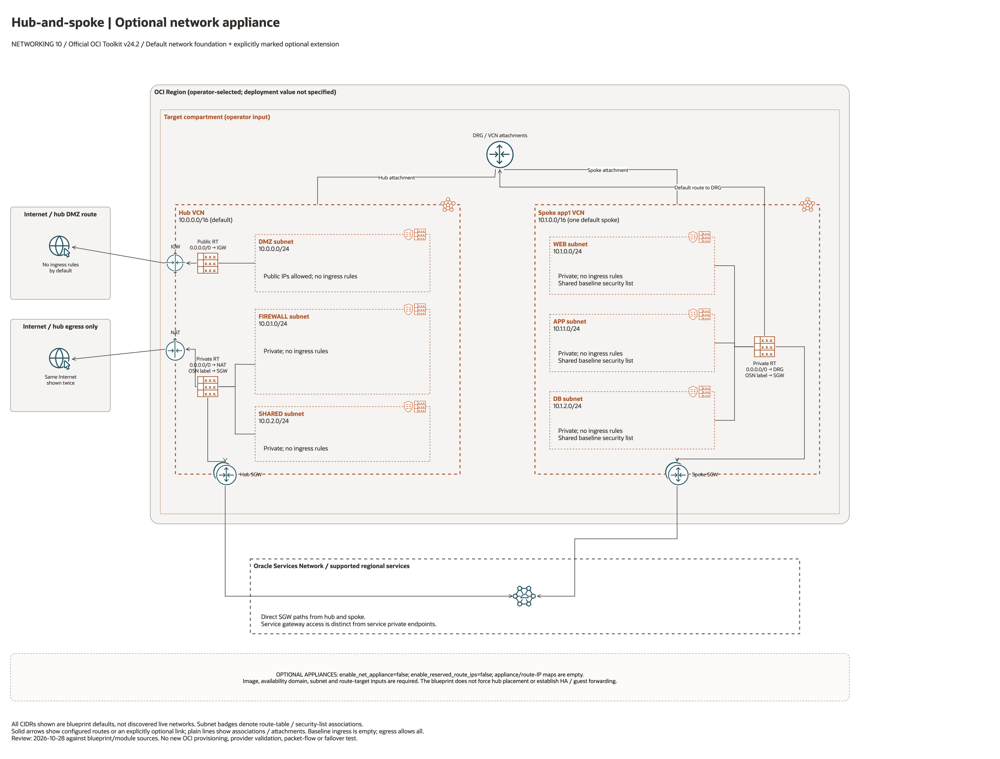

# Hub-Spoke Network Appliance Architecture

This is the deployment architecture for `blueprints/networking/hub-spoke-with-hub-vcn-net-appliance`. The PNG provides a GitHub-readable preview; the accompanying draw.io file preserves editable shapes, official OCI icons and connectors.

## Deployment Purpose

Adds network appliance route targets and reserved route IPs to a hub-spoke network for inspection or custom routing appliances.

## Architecture At A Glance

| Item | Details |
| --- | --- |
| Boundary | `blueprints/networking/hub-spoke-with-hub-vcn-net-appliance` owns this deployment folder and its Terraform + Ansible runners. |
| Purpose | Adds network appliance route targets and reserved route IPs to a hub-spoke network for inspection or custom routing appliances. |
| Terraform components | `network`, `net_appliance` |
| Primary architecture view | The diagram shows the default network foundation, attachments, routes and explicitly optional extensions; it is not runtime evidence. |

## Architecture

[Editable draw.io source](architecture.drawio). The PNG is the documentation preview.
Keep it aligned with the editable source after every diagram change.

Generated with the [oci-architecture-diagrams skill](https://github.com/leandro-michelino/oci-architecture-diagrams)
and Oracle OCI Architecture Diagram Toolkit v24.2. Regenerate from the repository
root with `python3 scripts/diagrams/networking-batch-02.py --render` after installing
the skill and its official toolkit. The toolkit itself is not stored in this repository.

This view shows the default network foundation. Optional services are explicitly
marked as disabled; their illustrated links are conditional. CIDRs are source
defaults, and the deployment region and compartment remain operator inputs.

Diagram documentation reviewed on 2026-10-28 against the blueprint, its pinned
hub/spoke foundation and referenced modules. No OCI resources were provisioned,
and no Terraform/provider validation date was changed for this documentation update.

## Terraform Components

| Kind | Name | Source Or Role |
| --- | --- | --- |
| Module | `network` | `blueprints/networking/hub-spoke-with-drg-and-three-tier-vcns @ d7938f4baef1aa512fc8dcee99a545ec17e0dab2` |
| Module | `net_appliance` | `modules/networking/net-appliance @ v0.2.0` |

## Request And Deployment Flow

- Operator reviews CIDRs, subnet maps, gateway flags, route targets, and inspection requirements.
- Terraform creates the network foundation first, then dependent attachments or network services declared in main.tf.
- Traffic follows the diagrammed route path, and outputs expose VCN, subnet, DRG, gateway, DNS, inspection, or policy IDs for the next deployment.

## Traffic And Trust Boundaries

- Control plane traffic is local operator or CI authentication into the OCI provider and the Ansible Terraform runner.
- Data plane traffic is the packet or service path shown in the Architecture diagram; if this deployment only creates identity or governance resources, the data plane is intentionally permission and signal flow instead of network packets.
- Trust boundaries are the tenancy, compartment, VCN, subnet, DRG, private endpoint, identity domain, or managed service edges shown in the diagram.
- Secrets, OCIDs, customer CIDRs, endpoint URLs, and contact data belong in ignored local tfvars or a secure pipeline variable store, not in committed files.

## Detailed Architecture Notes

- Current validation: The 2026-10-23 DEFAULT Sao Paulo plan includes only the hub/spoke network; NVA Compute and reserved route IPs are disabled by default. See [Networking review](../../../../docs/NETWORKING-REVIEW-20261023-61-70.md).

- Traffic arrows express intended topology. The default network contains one workload spoke and no application hosts. Routing, ingress permissions, DNS resolution, inspection, and failover need separate runtime acceptance tests.

- Preserve OCI provenance tags `Oracle-Tags.CreatedBy` and `Oracle-Tags.CreatedOn` in provider configuration; other defined tags remain managed.

- Deployment creates the declared network/service resources. DRG attachments alone do not prove hub-to-spoke reachability, centralized NAT, symmetric return routing, or inspected transit. Review VCN ingress routes, subnet routes, DRG route tables/distributions, and security rules before treating the diagram as an operational packet path.
- Multiple appliance instances and reserved route IPs do not configure an HA protocol, health-based failover, guest forwarding software, or route steering. Supply the appliance configuration and test failover separately.

These notes expand the diagram with the design details that usually matter during review, plan, and hand-off.

- The hub-spoke network is created first, then appliance route targets and reserved route IPs are created or referenced.
- Route tables can point selected traffic at appliance private IPs for inspection, NAT, routing, or third-party services.
- Existing route target private IP IDs let the pattern integrate with appliances created outside this folder.
- Appliance `licensing_configs` passes through OCI Compute license settings for eligible images, such as Windows BYOL. RHEL remains a bring-your-own-image/subscription workflow unless the selected marketplace image documents a different model.
- Review failover, route symmetry, appliance health checks, and security policy before steering production traffic.

## Operational Boundaries

- Keep customer-specific OCIDs, CIDRs, DNS names, endpoints, contacts, and secrets in ignored local tfvars or approved pipeline variables.
- Run plan from this blueprint folder so relative module paths, provider files, and local Ansible runners resolve predictably.
- Treat apply and destroy as approval-gated operations; use the guarded Ansible playbooks or a reviewed Terraform workflow.
- Re-check route exposure, IAM scope, compartment boundaries, tags, and output hand-offs whenever inputs change.

## Review Checklist

- Confirm the diagram matches `main.tf`: `network`, `net_appliance`.
- Confirm the described traffic path is the path you want in OCI before apply.
- Confirm public exposure, private endpoint access, DNS behavior, DRG routing, and inspection points are intentional where present.
- Confirm IAM scopes, compartment boundaries, tags, and operational outputs match the deployment README.
- Confirm `ansible/plan.yml`, `ansible/apply.yml`, and `ansible/destroy.yml` still point at the shared Terraform runner.
