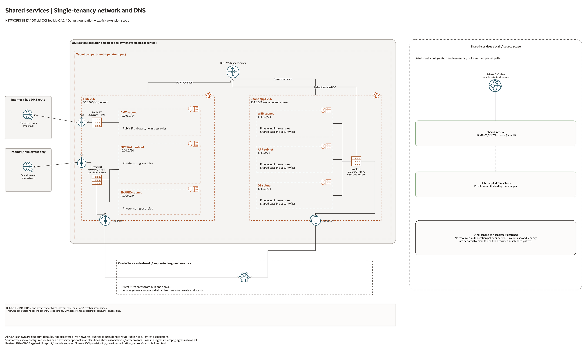

# Multi-Tenancy Shared Services Architecture

This is the deployment architecture for `blueprints/networking/multi-tenancy-shared-services`. The PNG provides a GitHub-readable preview; the draw.io source preserves editable shapes, official OCI icons and connectors.

## Deployment Purpose

Creates a hub-spoke shared services network and private DNS view that can serve multiple tenants or workload groups.

## Architecture At A Glance

| Item | Details |
| --- | --- |
| Boundary | `blueprints/networking/multi-tenancy-shared-services` owns this deployment folder and its Terraform + Ansible runners. |
| Purpose | Creates a hub-spoke shared services network and private DNS view that can serve multiple tenants or workload groups. |
| Terraform components | `network`, `shared_dns` |
| Primary architecture view | The diagram shows source-defined resources, explicit dependency/contract boundaries and conditional connectivity; it is not runtime evidence. |

## Architecture

[Editable draw.io source](architecture.drawio). Keep this source and the PNG preview
aligned after every diagram change.

Generated with the [oci-architecture-diagrams skill](https://github.com/leandro-michelino/oci-architecture-diagrams)
and Oracle OCI Architecture Diagram Toolkit v24.2. Regenerate from the repository
root with `python3 scripts/diagrams/networking-batch-04.py --render`, after
installing the skill and its official toolkit. The toolkit is not redistributed here.

The diagram uses source-default CIDRs, explicitly identifies incomplete inputs,
and distinguishes network resources from external dependencies and metadata
contracts. Placement labels are defaults or operator inputs, not live inventory.

Diagram documentation reviewed on 2026-10-28 against root Terraform, referenced
modules, and any accompanying CloudFormation/Bicep template. No cloud resources
were provisioned and no Terraform/provider validation date was changed.
This diagram is not evidence of connectivity, BGP, failover or DR readiness.

## Terraform Components

| Kind | Name | Source Or Role |
| --- | --- | --- |
| Module | `network` | `blueprints/networking/hub-spoke-with-drg-and-three-tier-vcns @ d7938f4baef1aa512fc8dcee99a545ec17e0dab2` |
| Module | `shared_dns` | `modules/networking/dns @ v0.2.0` |

## Request And Deployment Flow

- Operator reviews CIDRs, subnet maps, gateway flags, route targets, and inspection requirements.
- Terraform creates the network foundation first, then dependent attachments or network services declared in main.tf.
- Traffic follows the diagrammed route path, and outputs expose VCN, subnet, DRG, gateway, DNS, inspection, or policy IDs for the next deployment.

## Traffic And Trust Boundaries

- Control plane traffic is local operator or CI authentication into the OCI provider and the Ansible Terraform runner.
- Data plane traffic is the packet or service path shown in the Architecture diagram; if this deployment only creates identity or governance resources, the data plane is intentionally permission and signal flow instead of network packets.
- Trust boundaries are the tenancy, compartment, VCN, subnet, DRG, private endpoint, identity domain, or managed service edges shown in the diagram.
- Secrets, OCIDs, customer CIDRs, endpoint URLs, and contact data belong in ignored local tfvars or a secure pipeline variable store, not in committed files.

## Detailed Architecture Notes

- Current validation: The 2026-10-23 DEFAULT Sao Paulo plan includes private DNS by default. The earlier lifecycle used reduced network-only scope; cross-tenancy connectivity and DNS behavior remain untested. See [Networking review](../../../../docs/NETWORKING-REVIEW-20261023-61-70.md).

- Traffic arrows express intended topology. The default network contains one workload spoke and no application hosts. Routing, ingress permissions, DNS resolution, inspection, and failover need separate runtime acceptance tests.

- Preserve OCI provenance tags `Oracle-Tags.CreatedBy` and `Oracle-Tags.CreatedOn` in provider configuration; other defined tags remain managed.

- This folder creates a local OCI network and optional private DNS. It does not establish cross-tenancy peering, cross-tenancy IAM endorsements/admissions, or remote tenancy onboarding. Those dependencies need separate authorized configuration and validation; local success does not prove multi-tenancy connectivity.

These notes expand the diagram with the design details that usually matter during review, plan, and hand-off.

- The hub-spoke network provides shared routing between tenant/workload spokes and the hub shared services subnet.
- Private DNS creates a shared view and zones, then attaches that view to hub and spoke resolvers.
- Tenant workloads reach shared services through DRG routes and resolve service names through the shared private DNS view.
- Review tenant isolation, shared service CIDRs, resolver attachments, and zone ownership before onboarding tenants.

## Operational Boundaries

- Keep customer-specific OCIDs, CIDRs, DNS names, endpoints, contacts, and secrets in ignored local tfvars or approved pipeline variables.
- Run plan from this blueprint folder so relative module paths, provider files, and local Ansible runners resolve predictably.
- Treat apply and destroy as approval-gated operations; use the guarded Ansible playbooks or a reviewed Terraform workflow.
- Re-check route exposure, IAM scope, compartment boundaries, tags, and output hand-offs whenever inputs change.

## Review Checklist

- Confirm the diagram matches `main.tf`: `network`, `shared_dns`.
- Confirm the described traffic path is the path you want in OCI before apply.
- Confirm public exposure, private endpoint access, DNS behavior, DRG routing, and inspection points are intentional where present.
- Confirm IAM scopes, compartment boundaries, tags, and operational outputs match the deployment README.
- Confirm `ansible/plan.yml`, `ansible/apply.yml`, and `ansible/destroy.yml` still point at the shared Terraform runner.
