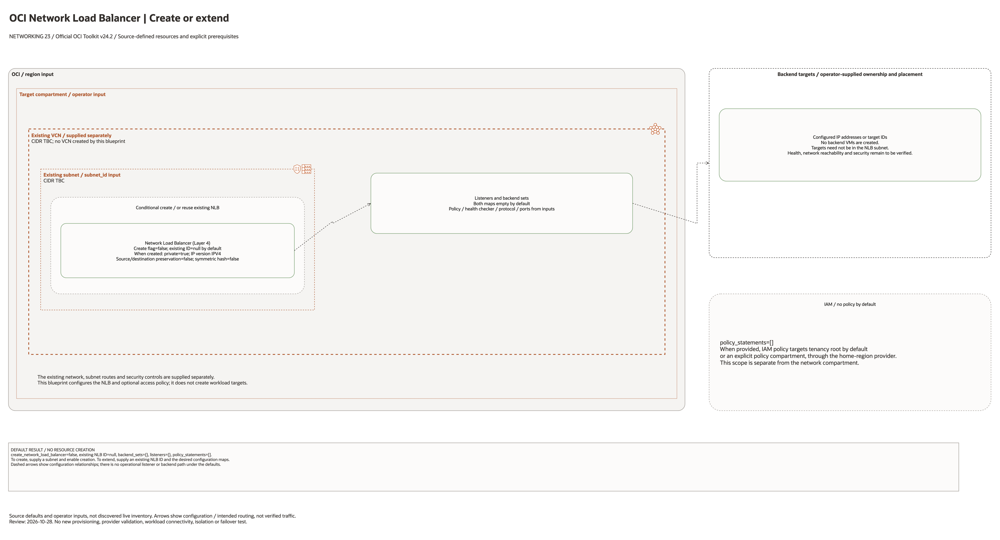

# Network Load Balancer Landing Zone Architecture

## Deployment Purpose

This blueprint implements an OCI Network Load Balancer pattern for Layer 4
traffic. It handles private or public NLB placement, backend sets, backend
registrations, health checks, listeners, source preservation options, and IAM.

## Architecture At A Glance

| Layer | Components |
| --- | --- |
| Entry | OCI Network Load Balancer in selected subnet. |
| Listener | TCP, UDP, or supported L4 listener ports. |
| Routing | Backend sets with health checks and load-balancing policy. |
| Targets | IP or target OCID backends in private application subnets. |
| Governance | NSGs, tags, IAM policy shell, and operator review. |

## Architecture

[Editable draw.io source](architecture.drawio). Keep the PNG aligned with this
editable source after diagram changes.

Generated with the [oci-architecture-diagrams skill](https://github.com/leandro-michelino/oci-architecture-diagrams)
and Oracle OCI Architecture Diagram Toolkit v24.2. Regenerate from the repository
root with `python3 scripts/diagrams/networking-batch-05.py --render`, after
installing the skill and its official toolkit. The toolkit is not redistributed here.

The diagram distinguishes source-defined resources, conditional enablement,
supplied network references and metadata contracts. CIDRs are source defaults or
explicitly marked TBC; deployment placement remains an operator input.

Diagram documentation reviewed on 2026-10-28 against root Terraform, referenced
modules and any accompanying Bicep template. No cloud resources were provisioned
and no Terraform/provider validation date was changed. The picture is not proof
of routing, backend health, traffic isolation, BGP or failover.

## Terraform Components

| File | Purpose |
| --- | --- |
| `main.tf` | Creates NLB, backend sets, backends, listeners, and optional IAM policy. |
| `variables.tf` | Defines exposure, subnet, NSG, backend set, backend, listener, and policy contracts. |
| `outputs.tf` | Exposes NLB ID, IPs, backend set names, listeners, and policy output. |
| `terraform.tfvars.example` | Shows a safe private TCP listener example. |

Declared resource addresses:

| Kind | Name | Source Or Role |
| --- | --- | --- |
| Resource | `oci_network_load_balancer_network_load_balancer.this` | Declared in this blueprint; creation depends on its count or for_each inputs. |
| Resource | `oci_network_load_balancer_backend_set.this` | Declared in this blueprint; creation depends on its count or for_each inputs. |
| Resource | `oci_network_load_balancer_backend.this` | Declared in this blueprint; creation depends on its count or for_each inputs. |
| Resource | `oci_network_load_balancer_listener.this` | Declared in this blueprint; creation depends on its count or for_each inputs. |
| Resource | `oci_identity_policy.access` | Declared in this blueprint; creation depends on its count or for_each inputs. |

## Request And Deployment Flow

1. Workload owner identifies protocol, port, and backend targets.
2. Network owner chooses private or public placement and NSG model.
3. Health check protocol and backend set policy are reviewed.
4. Terraform creates or references the NLB and adds backend sets.
5. Terraform registers backend targets and listeners.
6. Application owner receives listener and backend set outputs.

## Traffic And Trust Boundaries

- `is_private` defaults to true to avoid accidental public L4 exposure.
- Public NLBs require separate ingress, DNS, and security review.
- Backends should live in private subnets unless a customer exception exists.
- Source preservation changes routing and backend security expectations.
- NSGs and route tables remain the primary network controls around targets.

## Detailed Architecture Notes

- Current validation: The 2026-10-23 DEFAULT Sao Paulo plan made no changes because NLB creation is opt-in and no subnet or targets were supplied. The earlier lifecycle tested a private NLB with an empty backend set and listener, without backend traffic. See [review evidence](../../../../docs/NETWORKING-GOVERNANCE-REVIEW-20261023-71-80.md).

- Preserve OCI provenance tags `Oracle-Tags.CreatedBy` and `Oracle-Tags.CreatedOn` in provider configuration; other defined tags remain managed.

- Backend sets and listeners are map-driven so multiple protocols can be
  modeled without new files.
- Backends can be IP-based or target OCID-based depending on workload needs.
- Health checker values stay close to backend set definitions for review.
- Listener `backend_set_key` links to Terraform-created backend sets.
- Existing NLBs can be referenced with `network_load_balancer_id`.
- IAM policy creation is optional because many networking teams centralize it.

## Operational Boundaries

- Terraform does not install or configure backend applications.
- Terraform does not create DNS records or certificates for higher-layer flows.
- Health check behavior should be tested before cutover.
- Backend drain/offline flags are configuration choices, not deployment runbooks.
- Route symmetry and source preservation need customer network validation.

## Review Checklist

- Exposure is private unless public L4 ingress is explicitly approved.
- Listener ports and protocols match the workload.
- Backend targets are correct and reachable.
- Health checks are safe and meaningful.
- NSG and route table changes are reviewed.
- Source preservation settings are understood.
- IAM policy statements are scoped to network operators.
