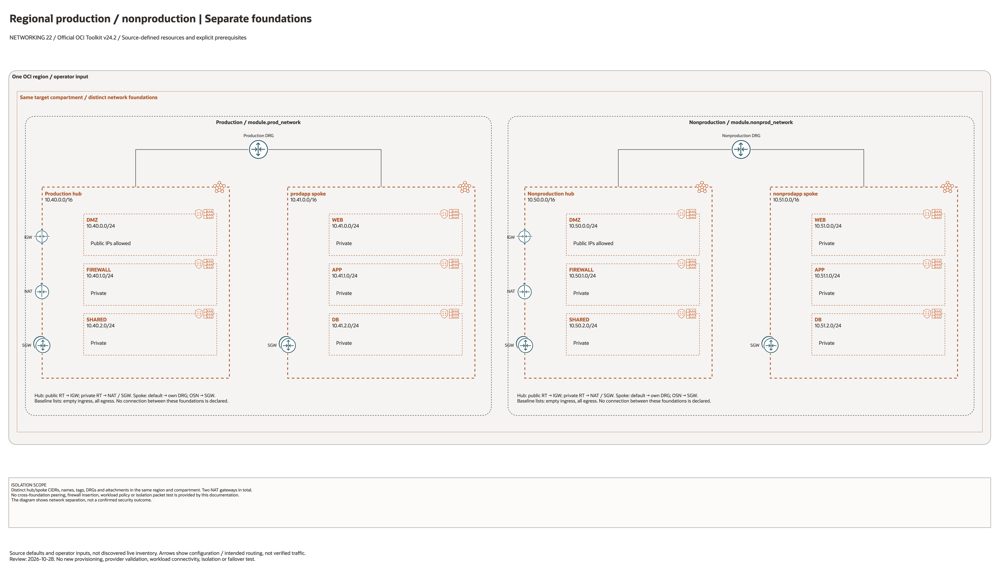

# Regional Prod Nonprod Hubs Architecture

This is the deployment architecture for `blueprints/networking/regional-prod-nonprod-hubs`. The PNG provides a GitHub-readable preview; the draw.io source preserves editable shapes, official OCI icons and connectors.

## Deployment Purpose

Creates separate prod and nonprod hub-spoke networks in the same region with distinct CIDR spaces and environment tags.

## Architecture At A Glance

| Item | Details |
| --- | --- |
| Boundary | `blueprints/networking/regional-prod-nonprod-hubs` owns this deployment folder and its Terraform + Ansible runners. |
| Purpose | Creates separate prod and nonprod hub-spoke networks in the same region with distinct CIDR spaces and environment tags. |
| Terraform components | `prod_network`, `nonprod_network` |
| Primary architecture view | The diagram shows default resources, conditional components and dependency boundaries; it is not runtime evidence. |

## Architecture

[Editable draw.io source](architecture.drawio). Keep the PNG aligned with this
editable source after diagram changes.

Generated with the [oci-architecture-diagrams skill](https://github.com/leandro-michelino/oci-architecture-diagrams)
and Oracle OCI Architecture Diagram Toolkit v24.2. Regenerate from the repository
root with `python3 scripts/diagrams/networking-batch-05.py --render`, after
installing the skill and its official toolkit. The toolkit is not redistributed here.

The diagram distinguishes source-defined resources, conditional enablement,
supplied network references and metadata contracts. CIDRs are source defaults or
explicitly marked TBC; deployment placement remains an operator input.

Diagram documentation reviewed on 2026-10-28 against root Terraform, referenced
modules and any accompanying Bicep template. No cloud resources were provisioned
and no Terraform/provider validation date was changed. The picture is not proof
of routing, backend health, traffic isolation, BGP or failover.

## Terraform Components

| Kind | Name | Source Or Role |
| --- | --- | --- |
| Module | `prod_network` | `blueprints/networking/hub-spoke-with-drg-and-three-tier-vcns @ d7938f4baef1aa512fc8dcee99a545ec17e0dab2` |
| Module | `nonprod_network` | `blueprints/networking/hub-spoke-with-drg-and-three-tier-vcns @ d7938f4baef1aa512fc8dcee99a545ec17e0dab2` |

## Request And Deployment Flow

- Operator reviews CIDRs, subnet maps, gateway flags, route targets, and inspection requirements.
- Terraform creates the network foundation first, then dependent attachments or network services declared in main.tf.
- Traffic follows the diagrammed route path, and outputs expose VCN, subnet, DRG, gateway, DNS, inspection, or policy IDs for the next deployment.

## Traffic And Trust Boundaries

- Control plane traffic is local operator or CI authentication into the OCI provider and the Ansible Terraform runner.
- Data plane traffic is the packet or service path shown in the Architecture diagram; if this deployment only creates identity or governance resources, the data plane is intentionally permission and signal flow instead of network packets.
- Trust boundaries are the tenancy, compartment, VCN, subnet, DRG, private endpoint, identity domain, or managed service edges shown in the diagram.
- Secrets, OCIDs, customer CIDRs, endpoint URLs, and contact data belong in ignored local tfvars or a secure pipeline variable store, not in committed files.

## Detailed Architecture Notes

- Current validation: The 2026-10-23 DEFAULT Sao Paulo plan proposed separate production and nonproduction VCN/DRG foundations in the selected compartment, including two NAT gateways. It did not verify traffic isolation. See [review evidence](../../../../docs/NETWORKING-GOVERNANCE-REVIEW-20261023-71-80.md).

- Preserve OCI provenance tags `Oracle-Tags.CreatedBy` and `Oracle-Tags.CreatedOn` in provider configuration; other defined tags remain managed.

These notes expand the diagram with the design details that usually matter during review, plan, and hand-off.

- Production and nonproduction networks are separate hub-spoke module instances in the same region.
- Each side has distinct hub CIDRs, spoke CIDRs, subnets, DRGs, and environment tags.
- There is no shared DRG between prod and nonprod in this deployment, so connectivity remains separated unless another layer connects them.
- Review CIDR separation, tags, route tables, and any future peering requirement before adding workloads.

## Operational Boundaries

- Keep customer-specific OCIDs, CIDRs, DNS names, endpoints, contacts, and secrets in ignored local tfvars or approved pipeline variables.
- Run plan from this blueprint folder so relative module paths, provider files, and local Ansible runners resolve predictably.
- Treat apply and destroy as approval-gated operations; use the guarded Ansible playbooks or a reviewed Terraform workflow.
- Re-check route exposure, IAM scope, compartment boundaries, tags, and output hand-offs whenever inputs change.

## Review Checklist

- Confirm the diagram matches `main.tf`: `prod_network`, `nonprod_network`.
- Confirm the described traffic path is the path you want in OCI before apply.
- Confirm public exposure, private endpoint access, DNS behavior, DRG routing, and inspection points are intentional where present.
- Confirm IAM scopes, compartment boundaries, tags, and operational outputs match the deployment README.
- Confirm `ansible/plan.yml`, `ansible/apply.yml`, and `ansible/destroy.yml` still point at the shared Terraform runner.
