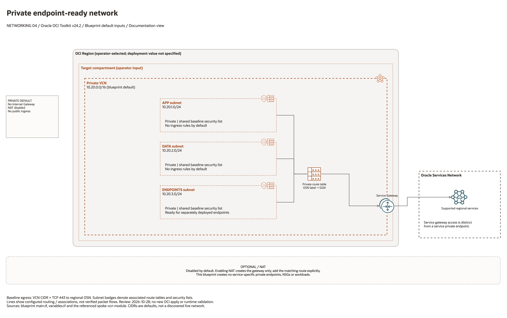

# Standalone Private Endpoint Only Architecture

This is the deployment architecture for `blueprints/networking/standalone-private-endpoint-only`. The PNG provides a GitHub-readable preview; the accompanying draw.io file preserves editable shapes and connectors.

## Deployment Purpose

Creates a private-only VCN pattern with service gateway access and optional NAT, designed for private endpoints and service access.

## Architecture At A Glance

| Item | Details |
| --- | --- |
| Boundary | `blueprints/networking/standalone-private-endpoint-only` owns this deployment folder and its Terraform + Ansible runners. |
| Purpose | Creates a private-only VCN pattern with service gateway access and optional NAT, designed for private endpoints and service access. |
| Terraform components | `private_vcn` |
| Primary architecture view | The diagram below shows the default configuration, ownership boundaries, and configured routes or identifier hand-offs. |

## Architecture

[Editable draw.io source](architecture.drawio). Open the source in draw.io and export
the PNG after edits so the GitHub preview stays aligned with the editable diagram.

The diagram shows the default input configuration and distinguishes managed,
external, and optional components. Arrows describe configured routes, associations,
or identifier hand-offs; they do not establish verified packet flows.

Generated with the [oci-architecture-diagrams skill](https://github.com/leandro-michelino/oci-architecture-diagrams)
and Oracle OCI Architecture Diagram Toolkit v24.2. Regenerate with
`python3 scripts/diagrams/networking-batch-01.py --render` from the repository root
after installing the skill and its official toolkit. The toolkit itself is not stored in this repository.

Diagram documentation reviewed on 2026-10-28 against `main.tf`, `variables.tf`,
and the referenced module or output contract. No OCI resources were provisioned
and no Terraform/provider validation date was changed for this documentation update.

## Terraform Components

| Kind | Name | Source Or Role |
| --- | --- | --- |
| Module | `private_vcn` | `modules/networking/spoke-vcn @ v0.2.0` |

## Request And Deployment Flow

- Operator reviews CIDRs, subnet maps, gateway flags, route targets, and inspection requirements.
- Terraform creates the network foundation first, then dependent attachments or network services declared in main.tf.
- Traffic follows the diagrammed route path, and outputs expose VCN, subnet, DRG, gateway, DNS, inspection, or policy IDs for the next deployment.

## Traffic And Trust Boundaries

- Control plane traffic is local operator or CI authentication into the OCI provider and the Ansible Terraform runner.
- Data plane traffic is the packet or service path shown in the Architecture diagram; if this deployment only creates identity or governance resources, the data plane is intentionally permission and signal flow instead of network packets.
- Trust boundaries are the tenancy, compartment, VCN, subnet, DRG, private endpoint, identity domain, or managed service edges shown in the diagram.
- Secrets, OCIDs, customer CIDRs, endpoint URLs, and contact data belong in ignored local tfvars or a secure pipeline variable store, not in committed files.

## Detailed Architecture Notes

- Current validation: The 2026-10-23 DEFAULT Sao Paulo plan proposed a private VCN without internet or NAT gateways. No private endpoint workload or traffic path was tested. See [review evidence](../../../../docs/NETWORKING-GOVERNANCE-REVIEW-20261023-71-80.md).

- This blueprint creates the VCN foundation, subnets, security lists, routes, service gateway, and optional NAT. It does not create NSGs or service-specific private endpoints. Deploy those separately and validate their DNS, IAM, and service support. A service gateway is not a private endpoint.

These notes expand the diagram with the design details that usually matter during review, plan, and hand-off.

- This VCN disables the Internet Gateway and is optimized for private endpoint and service gateway access.
- Private workloads use route tables, service gateway, optional NAT gateway, and private endpoint subnets to reach OCI services.
- Security lists and NSGs should be scoped around private endpoint consumers and service-specific traffic.
- Review whether NAT is truly required; leaving it disabled keeps the pattern private-only.

## Operational Boundaries

- Keep customer-specific OCIDs, CIDRs, DNS names, endpoints, contacts, and secrets in ignored local tfvars or approved pipeline variables.
- Run plan from this blueprint folder so relative module paths, provider files, and local Ansible runners resolve predictably.
- Treat apply and destroy as approval-gated operations; use the guarded Ansible playbooks or a reviewed Terraform workflow.
- Re-check route exposure, IAM scope, compartment boundaries, tags, and output hand-offs whenever inputs change.

## Review Checklist

- Confirm the diagram matches `main.tf`: `private_vcn`.
- Confirm the described traffic path is the path you want in OCI before apply.
- Confirm public exposure, private endpoint access, DNS behavior, DRG routing, and inspection points are intentional where present.
- Confirm IAM scopes, compartment boundaries, tags, and operational outputs match the deployment README.
- Confirm `ansible/plan.yml`, `ansible/apply.yml`, and `ansible/destroy.yml` still point at the shared Terraform runner.

## October 2026 Review Boundaries

Provider configuration ignores only OCI-managed `Oracle-Tags.CreatedBy` and `Oracle-Tags.CreatedOn`; customer-defined tags remain managed. Live validation covers network provisioning and cleanup, without workload packet-flow tests.

The default baseline permits HTTPS egress to the regional Oracle Services Network label, matching the service gateway route. Set `enable_service_gateway_https_egress=false` when supplying narrower service-specific rules. No service endpoint or workload is created.
