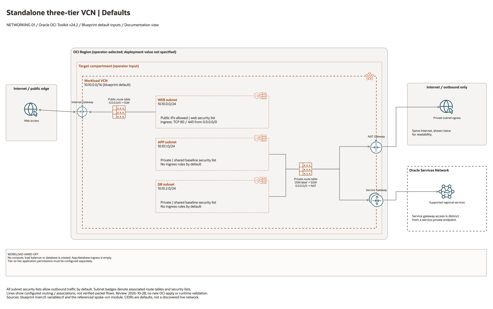

# Standalone Three-Tier VCN Defaults Architecture

This is the deployment architecture for `blueprints/networking/standalone-three-tier-vcn-defaults`. The PNG provides a GitHub-readable preview; the accompanying draw.io file preserves editable shapes and connectors.

## Deployment Purpose

Creates a straightforward standalone three-tier workload VCN using opinionated defaults for web, app, and database tiers.

## Architecture At A Glance

| Item | Details |
| --- | --- |
| Boundary | `blueprints/networking/standalone-three-tier-vcn-defaults` owns this deployment folder and its Terraform + Ansible runners. |
| Purpose | Creates a straightforward standalone three-tier workload VCN using opinionated defaults for web, app, and database tiers. |
| Terraform components | `workload_vcn` |
| Primary architecture view | The diagram below shows the default configuration, ownership boundaries, and configured routes or identifier hand-offs. |


## Architecture



[Editable draw.io source](architecture.drawio). Open the source in draw.io and export
the PNG after edits so the GitHub preview stays aligned with the editable diagram.

The diagram shows the default input configuration and distinguishes managed,
external, and optional components. Arrows describe configured routes, associations,
or identifier hand-offs; they do not establish verified packet flows.

Generated with the [oci-architecture-diagrams skill](https://github.com/leandro-michelino/oci-architecture-diagrams)
and Oracle OCI Architecture Diagram Toolkit v24.2. Regenerate with
`python3 scripts/diagrams/networking-batch-01.py --render` from the repository root
after installing the skill and its official toolkit. The toolkit itself is not stored in this repository.

Diagram documentation reviewed on 2026-10-28 against `main.tf`, `variables.tf`,
and the referenced module or output contract. No OCI resources were provisioned
and no Terraform/provider validation date was changed for this documentation update.

## Resource Detail And Coverage

Reviewed against the updated diagram standard on October 28, 2026. The main
draw.io document contains the topology overview plus every resource-detail and
existing-resource-reference page below. Source declarations include disabled and
collection-based resources from root Terraform, recursively pinned modules and
companion cloud templates. Counts are declarations, not resolved instance counts.

OCI uses Oracle Toolkit icons; Azure and AWS use their respective draw.io icons.
Types without a specific mapped icon retain their exact name and type in a box.
No GCP declarations were found in this fixed 39-blueprint scope.

| Detail page | Declarations | PNG | Editable source |
| --- | --- | --- | --- |
| OCI resources | 7 | [PNG](oci-resources.png) | [draw.io](oci-resources.drawio) |

[Existing resources and override inputs](existing-resources.png) | [Editable reference page](existing-resources.drawio)

[Source inventory](resource-inventory.json) records exact declarations, full
creation expressions, module call-site gates/enablement inputs, pinned revisions,
source hashes and diagram node mappings. Identifier-input references are listed
separately from managed resources. Null/empty inputs do not prove an external
resource exists; collection schemas may contain additional resource identifiers.

The overview explains default enablement. Resource cards enumerate all declaration
branches and do not imply deployment, ownership adoption, packet flow, security
enforcement or recovery success. No historical Terraform validation date changed.

```bash
python3 scripts/diagrams/multicloud-resource-coverage.py --blueprint networking/standalone-three-tier-vcn-defaults --render
python3 scripts/diagrams/multicloud-resource-coverage.py --blueprint networking/standalone-three-tier-vcn-defaults --check
```

If regenerating the overview first, rebuild these detail pages afterward.
See [the fixed first-39 review](../../../../docs/diagrams/FIRST-39-REVIEW.md) and [provider icon sources](../../../../scripts/diagrams/assets/README.md).

## Terraform Components

| Kind | Name | Source Or Role |
| --- | --- | --- |
| Module | `workload_vcn` | `modules/networking/spoke-vcn @ v0.2.0` |

## Request And Deployment Flow

- Operator reviews CIDRs, subnet maps, gateway flags, route targets, and inspection requirements.
- Terraform creates the network foundation first, then dependent attachments or network services declared in main.tf.
- Traffic follows the diagrammed route path, and outputs expose VCN, subnet, DRG, gateway, DNS, inspection, or policy IDs for the next deployment.

## Traffic And Trust Boundaries

- Control plane traffic is local operator or CI authentication into the OCI provider and the Ansible Terraform runner.
- Data plane traffic is the packet or service path shown in the Architecture diagram; if this deployment only creates identity or governance resources, the data plane is intentionally permission and signal flow instead of network packets.
- Trust boundaries are the tenancy, compartment, VCN, subnet, DRG, private endpoint, identity domain, or managed service edges shown in the diagram.
- Secrets, OCIDs, customer CIDRs, endpoint URLs, and contact data belong in ignored local tfvars or a secure pipeline variable store, not in committed files.

## Detailed Architecture Notes

- Current validation: The 2026-10-23 DEFAULT Sao Paulo plan proposed a default three-tier VCN with NAT and an internet gateway. No workload or packet path was tested. See [review evidence](../../../../docs/NETWORKING-GOVERNANCE-REVIEW-20261023-71-80.md).

- The public web subnet uses the `web` security list for HTTP/HTTPS ingress. App and database subnets use `baseline`, which has no ingress rules by default. Add only approved application-to-database flows through explicit inputs. Custom security list maps must include every key referenced by the subnet map.

These notes expand the diagram with the design details that usually matter during review, plan, and hand-off.

- This VCN creates a simple web/app/database tier pattern with Internet Gateway, NAT Gateway, and Service Gateway enabled.
- Public ingress should terminate in the web tier; app and database tiers should remain private unless inputs deliberately change that posture.
- Private outbound internet traffic should use NAT, while OCI service traffic should use the Service Gateway path.
- Review the default CIDRs and route behavior before reusing the pattern in a shared or production environment.

## Operational Boundaries

- Keep customer-specific OCIDs, CIDRs, DNS names, endpoints, contacts, and secrets in ignored local tfvars or approved pipeline variables.
- Run plan from this blueprint folder so relative module paths, provider files, and local Ansible runners resolve predictably.
- Treat apply and destroy as approval-gated operations; use the guarded Ansible playbooks or a reviewed Terraform workflow.
- Re-check route exposure, IAM scope, compartment boundaries, tags, and output hand-offs whenever inputs change.

## Review Checklist

- Confirm the diagram matches `main.tf`: `workload_vcn`.
- Confirm the described traffic path is the path you want in OCI before apply.
- Confirm public exposure, private endpoint access, DNS behavior, DRG routing, and inspection points are intentional where present.
- Confirm IAM scopes, compartment boundaries, tags, and operational outputs match the deployment README.
- Confirm `ansible/plan.yml`, `ansible/apply.yml`, and `ansible/destroy.yml` still point at the shared Terraform runner.

## October 2026 Review Boundaries

Provider configuration ignores only OCI-managed `Oracle-Tags.CreatedBy` and `Oracle-Tags.CreatedOn`; customer-defined tags remain managed. Live validation covers network provisioning and cleanup, without workload packet-flow tests.
