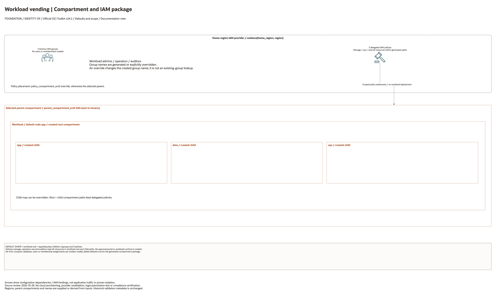

# Workload Vending Architecture

This is the deployment architecture for `blueprints/operating-entity/workload-vending`. The PNG provides a GitHub-readable preview; the draw.io source preserves editable shapes and official OCI icons.

## Deployment Purpose

Creates a workload compartment tree, workload IAM groups, and scoped policies for repeatable application onboarding.

## Architecture At A Glance

| Item | Details |
| --- | --- |
| Boundary | `blueprints/operating-entity/workload-vending` owns this deployment folder and its Terraform + Ansible runners. |
| Purpose | Creates a workload compartment tree, workload IAM groups, and scoped policies for repeatable application onboarding. |
| Terraform components | `compartments`, `groups`, `policies` |
| Primary architecture view | The diagram shows default enablement, compartment/IAM scope and configuration dependencies; it is not runtime evidence. |

## Architecture

[Editable draw.io source](architecture.drawio). Keep the source and PNG aligned
after diagram changes.

Generated with the [oci-architecture-diagrams skill](https://github.com/leandro-michelino/oci-architecture-diagrams)
and Oracle OCI Architecture Diagram Toolkit v24.2. From the repository root, run
`python3 scripts/diagrams/foundation-batch-02.py --render` after installing the
skill and official toolkit. The toolkit is not redistributed in this repository.

The view distinguishes default resources, conditional enablement, home-region
IAM, compartment hierarchy and delegated policy paths. It does not assert
workload provisioning, successful authorization or security certification.

Diagram documentation reviewed on 2026-10-28 against Terraform, variables, locals,
providers and referenced module definitions. No cloud resources were created
and no Terraform/provider validation date was updated. Arrows describe
configuration dependencies or IAM bindings, not verified packet paths.

## Terraform Components

| Kind | Name | Source Or Role |
| --- | --- | --- |
| Module | `compartments` | `modules/iam/compartments @ v0.2.0` |
| Module | `groups` | `modules/iam/groups @ v0.2.0` |
| Module | `policies` | `modules/iam/policies @ v0.2.0` |

## Request And Deployment Flow

- Operator supplies the entity or workload shape and parent compartment.
- Terraform creates the compartment boundary, then IAM groups, then scoped policies.
- Outputs hand compartment IDs, group names, and policy statements to platform and app teams.

## Traffic And Trust Boundaries

- Control plane traffic is local operator or CI authentication into the OCI provider and the Ansible Terraform runner.
- Data plane traffic is the packet or service path shown in the Architecture diagram; if this deployment only creates identity or governance resources, the data plane is intentionally permission and signal flow instead of network packets.
- Trust boundaries are the tenancy, compartment, VCN, subnet, DRG, private endpoint, identity domain, or managed service edges shown in the diagram.
- Secrets, OCIDs, customer CIDRs, endpoint URLs, and contact data belong in ignored local tfvars or a secure pipeline variable store, not in committed files.

## Detailed Architecture Notes

- Current validation: The 2026-10-23 check covered Terraform schema only. Workload IAM groups are tenancy-root resources requiring the home region, so no Sao Paulo live plan or deployment was attempted. See [review evidence](../../../../docs/NETWORKING-GOVERNANCE-REVIEW-20261023-71-80.md).

These notes expand the diagram with the design details that usually matter during review, plan, and hand-off.

- The workload root and child compartments are created first, followed by workload-specific groups and scoped policies.
- This deployment is the application-team onboarding path for repeatable workload boundaries.
- It does not create network resources; it prepares the compartment and IAM scope where network and app blueprints can land.
- Review workload_code, workload_name, child compartment shape, and policy scope before handing the boundary to an app team.

## Operational Boundaries

- Keep customer-specific OCIDs, CIDRs, DNS names, endpoints, contacts, and secrets in ignored local tfvars or approved pipeline variables.
- Run plan from this blueprint folder so relative module paths, provider files, and local Ansible runners resolve predictably.
- Treat apply and destroy as approval-gated operations; use the guarded Ansible playbooks or a reviewed Terraform workflow.
- Re-check route exposure, IAM scope, compartment boundaries, tags, and output hand-offs whenever inputs change.

## Review Checklist

- Confirm the diagram matches `main.tf`: `compartments`, `groups`, `policies`.
- Confirm the described traffic path is the path you want in OCI before apply.
- Confirm public exposure, private endpoint access, DNS behavior, DRG routing, and inspection points are intentional where present.
- Confirm IAM scopes, compartment boundaries, tags, and operational outputs match the deployment README.
- Confirm `ansible/plan.yml`, `ansible/apply.yml`, and `ansible/destroy.yml` still point at the shared Terraform runner.
