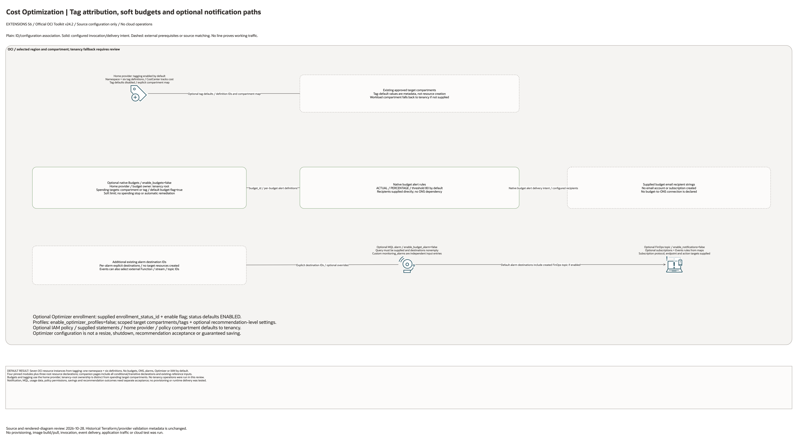

# Cost Optimization Architecture

This page is the deployment architecture for
`blueprints/operations/cost-optimization`. It is intentionally Architecture-first so it
is easy to review in GitHub, terminals, pull requests, runbooks, and customer
notes without a diagramming tool.

## Deployment Purpose

Deploys a FinOps control layer with cost-tracking tags, optional tag defaults,
budgets, budget alert rules, notification topics, optional Monitoring alarms,
optional Optimizer profiles, and an optional FinOps access policy.

## Architecture At A Glance

| Item | Details |
|---|---|
| Boundary | `blueprints/operations/cost-optimization` owns this deployment folder and its Terraform + Ansible runners. |
| Purpose | Turns cost governance into a repeatable blueprint instead of a spreadsheet exercise. |
| Terraform components | `module.tagging`, `module.budgets`, `module.notifications`, `module.monitoring`, `oci_optimizer_enrollment_status.this`, `oci_optimizer_profile.this`, `oci_identity_policy.finops_access` |
| Primary architecture view | The Architecture diagram below shows the OCI components, dependency order, and signal flow for this exact deployment. |

## Architecture

[Editable overview and native resource pages](architecture.drawio) · [Source inventory](resource-inventory.json)

## Terraform Components

| Kind | Name | Source Or Role |
|---|---|---|
| Module | `module.tagging` | Creates the FinOps tag namespace, tag definitions, and optional tag defaults. |
| Module | `module.budgets` | Creates default and custom budgets plus budget alert rules. |
| Module | `module.notifications` | Creates the FinOps ONS topic, subscriptions, and optional Events rules. |
| Module | `module.monitoring` | Creates optional Monitoring alarms that publish to ONS destinations. |
| Resource | `oci_optimizer_enrollment_status.this` | Optionally manages Optimizer enrollment when the customer supplies the identifier. |
| Resource | `oci_optimizer_profile.this` | Creates Optimizer profiles scoped by target compartments or tags. |
| Resource | `oci_identity_policy.finops_access` | Creates an optional IAM policy for FinOps operators. |

## Request And Deployment Flow

- Operator identifies the landing-zone compartments that need cost ownership,
  tag defaults, and budget tracking.
- Finance or platform owners approve cost-center values, budget thresholds, and
  alert recipients before local tfvars are created.
- Terraform creates tag definitions first, then budget and notification
  resources, then optional alarms, Optimizer resources, and IAM policy.
- Budget alert rules send direct recipient email through OCI Budgets.
- Optional Monitoring alarms publish to the FinOps ONS topic or supplied topic
  OCIDs.
- Outputs expose the IDs needed by finance reports, runbooks, and downstream
  automation.

## Traffic And Trust Boundaries

- Control plane traffic is local operator or CI authentication into the OCI
  provider and the Ansible Terraform runner.
- Tagging and IAM policy operations use the home-region provider because those
  APIs are tenancy and identity-plane sensitive.
- Budgets use the home-region provider and tenancy-root ownership; spending
  targets are separate. Notifications, monitoring and Optimizer use regional
  configuration and their supplied target compartment references.
- ONS subscriptions may point to email or webhook endpoints outside OCI; treat
  those endpoints as external trust boundaries.
- Recipients, webhook URLs, OCIDs, and policy statements belong in ignored local
  tfvars or secure pipeline variables, not committed examples.

## Detailed Architecture Notes

- Current validation: The 2026-10-23 checks covered Terraform schema and one mocked home-provider test only. Tagging is enabled by default and uses the home-region provider; no live plan, cost estimate, or resource creation was performed. See [review evidence](../../../../docs/NETWORKING-GOVERNANCE-REVIEW-20261023-71-80.md).

- Tag defaults are intentionally separate from tag definitions. Create tag
  definitions broadly, then enforce defaults only where the operating model is
  ready.
- Budget alert rules are native OCI Budgets alerts and use recipient email
  strings. They do not require ONS.
- The FinOps ONS topic is still useful for Monitoring alarms, Events rules, and
  webhook-style integrations.
- The default Monitoring alarm is query-driven. The blueprint requires the MQL
  query to come from local inputs because cost metric naming can differ by
  tenancy, service, and reporting model.
- Optimizer enrollment is optional because some tenancies already manage it
  centrally. The profile resource is safer to use for scoped recommendations.
- The IAM policy is empty by default so teams can review exact group names,
  verbs, and compartments before granting access.

## Operational Boundaries

- Keep customer-specific OCIDs, recipients, webhook URLs, and IAM group names in
  ignored local tfvars or approved pipeline variables.
- Run plan from this blueprint folder so pinned Git module sources, provider
  files, and local Ansible runners resolve predictably.
- Treat apply and destroy as approval-gated operations; use the guarded Ansible
  playbooks or a reviewed Terraform workflow.
- Re-check tag defaults, budget targets, alert thresholds, notification
  destinations, Optimizer scope, and IAM statements whenever finance ownership
  changes.
- Use `scripts/validate-changed.sh` for normal edits to this blueprint and
  `scripts/validate-all.sh` before release-wide changes.

## Review Checklist

- Confirm the diagram matches `main.tf`: `module.tagging`, `module.budgets`,
  `module.notifications`, `module.monitoring`,
  `oci_optimizer_enrollment_status.this`, `oci_optimizer_profile.this`, and
  `oci_identity_policy.finops_access`.
- Confirm cost-center and owner tag names match the customer reporting model.
- Confirm tag defaults target only approved compartments.
- Confirm budget targets, thresholds, reset periods, recipients, and custom
  budget maps.
- Confirm ONS topics and subscriptions point to approved notification owners.
- Confirm Monitoring alarm queries are tested in the target tenancy before
  apply.
- Confirm Optimizer profiles do not accidentally cover compartments outside
  the intended FinOps scope.
- Confirm IAM policy statements are least-privilege and reference existing
  groups.
- Confirm `ansible/plan.yml`, `ansible/apply.yml`, and `ansible/destroy.yml`
  still point at the shared Terraform runner.

## Budget Dependency Follow-Up

The Budget dependency selects the published root-ownership fix and inherits the home-region provider. Budget ownership is tenancy root; spending targets remain separate. This administrative operation was tested with mocked providers, not created in the workload compartment. Budgets are soft limits, not an automatic spending cap.

## Diagram Review - 2026-10-28

The source defaults create one tag namespace and six tag definitions if applied with valid inputs. This review generated documentation only. Tag defaults and all budget, notification, alarm, Optimizer and IAM branches remain conditional. Native Budget alerts send directly to configured recipients, independently of ONS. Alarm queries and event targets are supplied; no automatic budget metric, recommendation acceptance or resource resizing is installed. All transitive pinned-module declarations and existing reference inputs appear in the native detail pages. No cloud resources, alerts, budgets, savings or runtime delivery were tested. Historical validation dates and scopes are unchanged.
