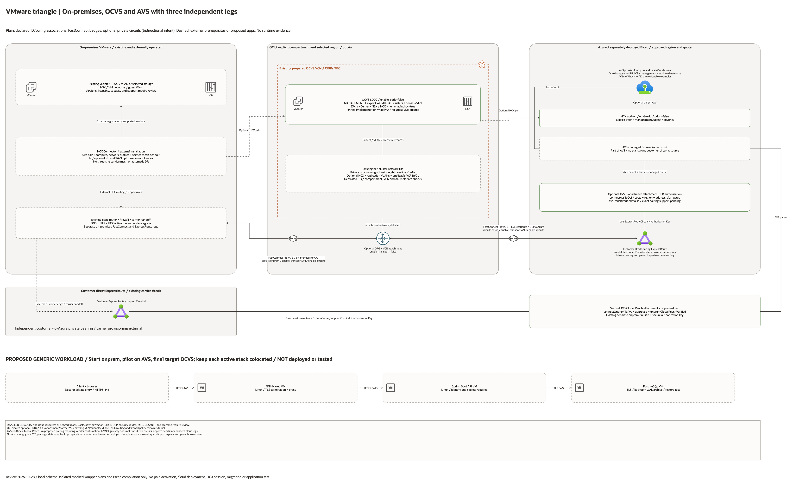

# Azure AVS, OCVS and On-Premises Triangle Architecture

## Deployment Purpose

Three independent private connectivity legs for staged VMware migration.
This is a source-bounded proposed topology, not an observation of running sites.

## Architecture At A Glance

| Item | Details |
| --- | --- |
| OCI | Pinned OCVS SDDC composition, optional DRG, attachment and private partner circuits. |
| VMware | Service-managed vCenter/ESXi/NSX/vSAN and optional HCX; existing remote site components. |
| Applications | Proposed generic web/API/database guest VMs; not provisioned. |
| Defaults | All creation, cost and prerequisite-confirmation flags false. |
| Existing resources | Prepared network IDs, licenses and any externally managed VMware sites. |

## Architecture

[Editable overview and native resource pages](architecture.drawio) · [Source inventory](resource-inventory.json)

Plain lines show declared ID/configuration associations. Solid arrows identify
configured physical/circuit intent only; dashed arrows identify external steps
or proposed application flows. All optional resources retain their enablement
conditions in the companion declaration maps.

## Terraform Components

- `module.ocvs` pins the OCVS implementation at commit `94ad89026bbf2ddbda531976a500e6d2ee084c7f`.
- `terraform_data.connectivity_guard` checks costs, transport prerequisites, required site roles and Azure BGP pairs.
- `terraform_data.migration_contract` stores non-secret hand-off metadata; it does not configure HCX.
- `oci_core_drg.this` and `oci_core_drg_attachment.ocvs` connect the prepared VCN when transport is enabled.
- `oci_core_virtual_circuit.site` declares a private partner circuit per configured site role.
- The pinned module has one optional SDDC declaration, one guard and read-only VCN/subnet/VLAN lookups.

## Request And Deployment Flow

- Operator selects network IDs, versions, shape, quota, licenses and approved cost scope.
- Review the disabled default plan, then enable cloud components in separate reviewed stages.
- Complete external partner provisioning, route/security/DNS configuration and HCX workflow.
- Run application, migration and restore acceptance independently of infrastructure validation.

## Traffic And Trust Boundaries

- Existing subnet and VLAN sets stay in the selected VCN and explicit compartment.
- The on-premises environment and Azure resources sit outside the OCI region boundary.
- No Internet-facing application, default Internet route, credentials or password output is introduced.
- Private transport does not automatically encrypt application traffic; use TLS and review HCX tunnel requirements.
- Verify DRG import/export filters, return paths, NSX policy and all routed address ranges.

## Detailed Architecture Notes

- The customer datacenter has a direct, independent ExpressRoute leg into Azure/AVS: edge router/firewall to the externally provisioned customer circuit, then the optional `onprem-direct` Global Reach attachment to the AVS-managed circuit.
- The customer circuit uses `onpremCircuitId` and a securely supplied authorization key. It is distinct from the customer Oracle-facing ExpressRoute circuit used for FastConnect/OCI Interconnect.
- The diagram explicitly shows the customer circuit with the Azure ExpressRoute glyph. The customer/carrier creates and operates it; this blueprint creates only the optional AVS attachment.

- OCVS host/cluster controls are inherited from the pinned component, not reimplemented.
- HCX activation/update egress and on-premises Connector installation are external.
- HCX site pairing and service mesh must be configured separately for each supported pair.
- VLAN/subnet route tables, NSX segments and firewall policies are separately owned existing infrastructure.
- The proposed web/API/database flow and placements are described in [the workload guide](../../../../docs/multicloud/VMWARE-WORKLOADS.md).
- No guest VM, database, backup job, replica or failover is created by infrastructure flags.

## Operational Boundaries

- Azure AVS-to-OCI transit support requires vendor/region confirmation; it is not inferred from circuit creation.
- A VNet ExpressRoute gateway does not transit traffic between two circuits.
- On-premises must use its own connections to each cloud; do not hairpin across Oracle Interconnect.
- Region, existing CIDRs, entitlement, quota and capacity remain explicit operator selections.
- No regional pair, host capacity, application latency, HA, RPO, RTO or certification is guaranteed.
- All static validation evidence is [recorded separately](../../../../docs/VMWARE-HYBRID-20261028.md).

## Review Checklist

- Check every declared resource, condition and existing input against the native detail pages.
- Confirm approved costs, compatible versions, no CIDR overlap and provider offering eligibility.
- Verify all circuit sessions, route filters, MTU, DNS/NTP and HCX management/uplink paths.
- Test application transactions and database consistency before and after migration.
- Exercise backup/restore and rollback before an application cutover.

## Independent FastConnect and ExpressRoute legs

The overview explicitly separates three legs:

1. **On-premises edge ↔ private FastConnect ↔ OCI DRG**, then the DRG attachment to the prepared OCVS VCN. OCI creates `oci_core_virtual_circuit.site["onprem"]` from `circuits.onprem` when transport/circuit creation is enabled and its guards pass.
2. **OCI DRG ↔ private FastConnect ↔ Oracle-facing ExpressRoute**, with `oci_core_virtual_circuit.site["azure"]` from `circuits.azure` under the same flags/guards. The optional AVS attachment remains separately gated and requires support confirmation.
3. **On-premises edge ↔ independent customer ExpressRoute ↔ AVS**, using the existing customer circuit and optional `onprem-direct` Global Reach attachment. This direct customer-to-Azure leg is retained; it does not traverse OCI.

Both OCI circuits require `enable_transport=true`, `enable_circuits=true`, cost approval, verified prerequisites and exactly the required `onprem`/`azure` map keys. Carrier handoffs, BGP sessions, route propagation, NSX/firewall rules and DNS need independent acceptance. HCX pairing does not replace any of these physical/private transport legs.

Diagram review: 2026-10-28, source/configuration and rendered PNG only. Bidirectional FastConnect badges describe private transport intent; they do not prove BGP establishment, route symmetry, HCX operation or working application traffic. No infrastructure settings or creation defaults changed.
