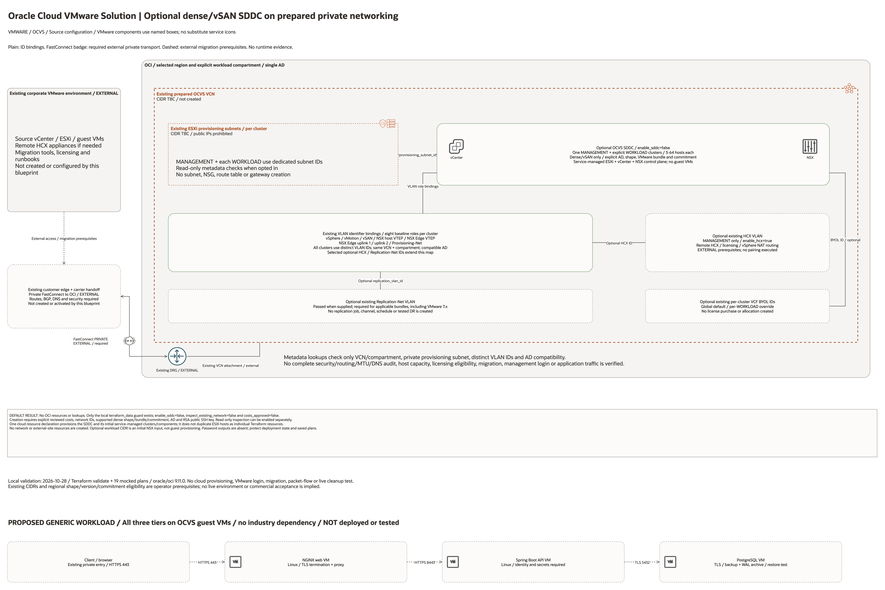

# Oracle Cloud VMware Solution Architecture

## Deployment Purpose

Create an optional dense/vSAN OCVS SDDC and initial MANAGEMENT plus explicitly configured WORKLOAD clusters on an
operator-prepared existing private network. This is a single-region,
single-AD, multi-host variant with cloud creation disabled by default.

## Architecture At A Glance

| Layer | Responsibility |
| --- | --- |
| Existing VCN and provisioning subnet | Network placement; no CIDR is invented. |
| Existing baseline VLANs | vSphere, vMotion, vSAN, NSX host/Edge VTEP, two Edge uplinks and Provisioning-Net. |
| Optional existing VLANs | Replication-Net for applicable bundles and HCX when enabled. |
| SDDC | Initial MANAGEMENT and WORKLOAD clusters, selected dense hosts, managed VMware control plane. |
| Local guard | Cost acknowledgement, identifiers, metadata ownership, private subnet, AD and name constraints. |
| External systems | Corporate transport/DNS, source vCenter/HCX, guest workloads, backup and operational integrations. |

## Architecture

[Edit the multi-page draw.io diagram](architecture.drawio). Complete declaration
and existing-identifier pages are embedded in the native document; see the
[source inventory](resource-inventory.json).

Plain lines show configured resource-ID associations. Dashed lines show
external private access or migration prerequisites. The SDDC box summarizes
service-managed VMware components, not separately declared Compute resources.
No connector proves working access, migration or service traffic.

## Terraform Components

| Component | Source role |
| --- | --- |
| `terraform_data.guard` | Local validation/metadata only; creates no cloud service. |
| `oci_ocvp_sddc.this` | Optional SDDC using nested initial cluster/network configuration. |
| `data.oci_core_vcn.existing` | Read-only existing VCN metadata. |
| `data.oci_core_subnet.provisioning` | Read-only existing per-cluster provisioning subnet metadata. |
| `data.oci_core_vlan.existing` | Read-only selected VLAN metadata per role. |

## Request And Deployment Flow

1. Review regional service support, commercial terms and existing licenses.
2. Prepare the private OCVS network and exact workload compartment outside this blueprint.
3. Optionally inspect existing network metadata with SDDC creation still off.
4. Supply cluster AD, supported VMware bundle/dense shape, RSA public SSH key and commitment.
5. Review a separately authorized creation plan and its explicit cost acknowledgement.
6. Hand management FQDN outputs to authorized operators over an independently configured private path.

## Traffic And Trust Boundaries

- The SDDC and existing network stay in the supplied compartment and VCN.
- The provisioning subnet prohibits public IPs; this does not prove private endpoint reachability.
- vSphere management, storage, mobility and NSX VLAN functions are distinct identifier bindings.
- Edge uplink VLANs are existing networks, not created FastConnect/VPN gateways.
- On-premises vCenter, remote HCX, transport and DNS remain external resources.
- No foreign-cloud account, source-site appliance or guest VM is provisioned.

## Detailed Architecture Notes

The baseline requires eight baseline VLAN roles per cluster, with globally distinct existing IDs. Supply
Replication-Net when the selected VMware bundle requires it, including the
VMware 7.x network model. Enabling HCX requires its own VLAN; licensing, NAT
routing for the vSphere network and remote-site pairing remain prerequisites.
The blueprint does not automatically resolve those version-specific requirements.

Management host count defaults to three, and each workload entry defaults to
three, while creation remains off. At least one explicit WORKLOAD entry is
required; the management network and every workload network have separate
provisioning subnet/VLAN sets. Dense shape, OCPUs,
VMware bundle and commitment are source inputs, not discovered capacity or
commercial quotes. The existing VCF BYOL allocation is passed through when supplied.
Standard/block-storage shapes, single-host and multi-AD variants are excluded.

Read-only metadata checks cover compartment/VCN, private provisioning subnets,
AD compatibility and distinct VLAN IDs. NSG matrices, route tables, DNS, CIDR
overlap and actual traffic require separate review and acceptance testing.

## Operational Boundaries

- No network creation, IAM changes, circuits, license purchases or allocations are declared.
- No independent ESXi-host resource duplicates the hosts in the SDDC's initial clusters.
- No password output is published; protect provider-held credentials in deployment state and saved plans.
- Guest provisioning, HCX service meshes/migration, backups, DR and monitoring are external operational work.
- Source-derived draw.io/PNG coverage is documentation evidence, not a live deployment or migration result.

## Review Checklist

- Confirm every existing network identifier belongs to the intended VCN/compartment.
- Verify Oracle's complete security/routing/network prerequisites for the selected bundle.
- Verify AD, supported shape/OCPUs, bundle, quota, licensing and commitment.
- Confirm 16-character SDDC and 22-character cluster name limits.
- Review HCX and Replication-Net requirements without assuming a working migration path.
- Review replacement/destruction and protect all deployment credentials.
- Keep enablement flags false during local schema/mock validation.

## Generic Workload Proposals

The proposed NGINX web, Spring Boot API and PostgreSQL guest VM stack appears
below the infrastructure overview, with dashed HTTPS/TLS application flows.
Exact bundled VMware icons identify vCenter, NSX Manager and guest VMs; the
OCVS SDDC retains a named component box. These proposals create no guest VMs,
packages, database, network rules, replication or backup jobs. See the
[generic placement and acceptance guide](../../../../docs/multicloud/VMWARE-WORKLOADS.md).
Historical infrastructure validation metadata remains unchanged.

## Required external FastConnect path

The overview now shows the customer edge/carrier handoff connected through **private FastConnect** to an **existing external DRG**, then its existing VCN attachment to the prepared OCVS VCN. This base blueprint creates only the optional SDDC, not the circuit, DRG, attachment, carrier handoff, BGP sessions, routes or DNS. The FastConnect badge expresses the requested external topology; it does not indicate an active circuit. Use the HCX hybrid wrapper when optional DRG/attachment/partner-circuit creation is required.

Diagram review: 2026-10-28, source/configuration and rendered PNG only. Bidirectional FastConnect badges describe private transport intent; they do not prove BGP establishment, route symmetry, HCX operation or working application traffic. No infrastructure settings or creation defaults changed.
